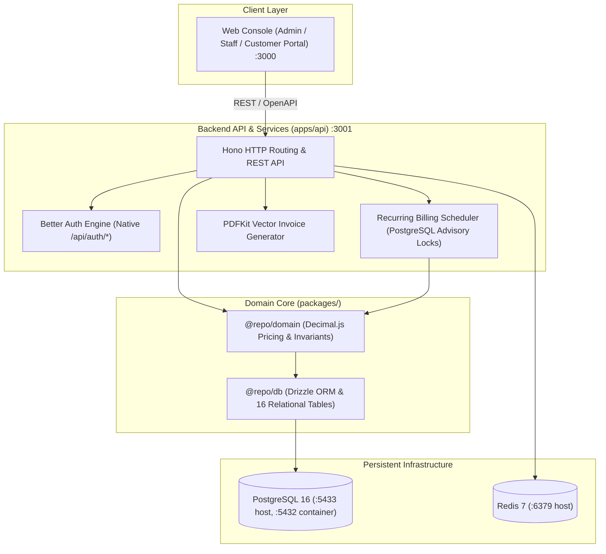

# Brightloop Subscription Management System

> **A high-performance, precision-engineered platform for recurring billing, subscription lifecycles, automated invoicing, payment reconciliation, and financial operations.**

---

## 1. System Overview

Brightloop is built as a **TypeScript Modular Monolith** adhering to strict financial data integrity, zero floating-point arithmetic, and an Industrial Precision design language.



---

## 2. Quickstart Guide (Local Development)

### 2.1 Prerequisites
- Node.js `>= 20.0.0`
- pnpm `>= 9.0.0`
- Docker Engine & Docker Compose

### 2.2 Setup Commands

```bash
# 1. Clone & install workspace dependencies
pnpm install

# 2. Copy environment file
cp .env.example .env

# 3. Start local Docker PostgreSQL 16 & Redis 7
pnpm docker:up

# 4. Run Drizzle database migrations
pnpm db:migrate

# 5. Seed demo business dataset (Admin, Staff, Customer, Products, Plans)
pnpm db:seed

# 6. Launch development servers (Web on :3000, API on :3001)
pnpm dev
```

Open [http://localhost:3000](http://localhost:3000) in your browser.

---

## 3. Automated Testing (32 / 32 Tests Passing)

```bash
# Run all unit and component tests (26 tests via Vitest)
pnpm test

# Run browser end-to-end tests (6 tests via Playwright in Chromium)
pnpm test:e2e

# Run complete test verification (32 tests total)
pnpm test:all
```

---

## 4. Documentation Library

Complete documentation is organized in the [`docs/`](docs/) directory:

- 📘 [**Local Development Runbook**](docs/guides/local-runbook.md)
- 🚀 [**Production Hosting & Deployment Runbook**](docs/guides/hosting-and-deployment.md)
- 🗄️ [**Database Schema & Seed Data Inventory**](docs/guides/database-and-seeding.md)
- 🧪 [**Automated Testing Guide (Vitest + Playwright)**](docs/guides/testing-guide.md)
- 🏛️ [**System Architecture & Topology**](docs/architecture/system-overview.md)
- ⚙️ [**Technology Stack Matrix**](docs/architecture/technology-stack.md)
- ⚖️ [**Architectural Decisions (ADRs)**](docs/architecture/decisions.md)
- 🔄 [**Automated Billing Engine & Scheduler**](docs/domain/billing-and-scheduler.md)
- 💰 [**Pricing Engine & Financial Invariants**](docs/domain/pricing-and-invariants.md)
- 📐 [**Data Models & Entity Relationships**](docs/domain/data-models.md)
- 🎨 [**UI Deslopification Standard**](docs/design/deslopification-standard.md)
- 🎛️ [**Industrial Precision Design System**](docs/design/industrial-precision.md)

---

## 5. License
Private and confidential. Copyright &copy; 2026 Brightloop. All rights reserved.
