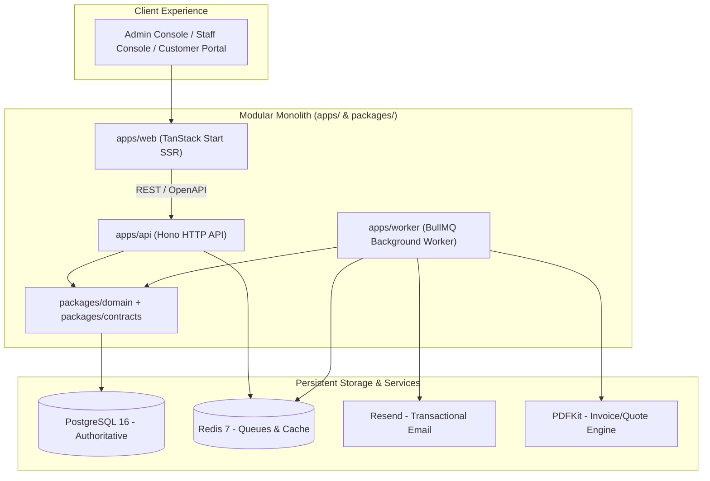

# Brightloop Subscription Management System

> **A unified, high-performance platform for managing recurring plans, customer subscriptions, automated invoicing, payment reconciliation, and real-time financial reporting.**

---

## 1. System Architecture

Brightloop is architected as a **TypeScript Modular Monolith** with separately runnable containerized processes for the web interface, API, and background workers:



---

## 2. Core Technology Stack

| Layer | Technology | Primary Role |
|---|---|---|
| **Web Frontend** | [TanStack Start](docs/02-stack/frontend-tanstack-start.md) | Full-stack React SSR, type-safe routing, optimistic UI |
| **Backend API** | [Hono](docs/02-stack/backend-hono.md) | Lightweight HTTP API, thin controllers, `@hono/zod-openapi` |
| **Primary Database** | [PostgreSQL 16](docs/02-stack/database-postgresql-drizzle.md) | Relational source of truth, ACID transactions, financial integrity |
| **Database ORM** | [Drizzle ORM](docs/02-stack/database-postgresql-drizzle.md) | Type-safe schema definitions and version-controlled SQL migrations |
| **Authentication** | [Better Auth](docs/02-stack/authentication-better-auth.md) | Sessions, cookies, password resets, and role-based access control |
| **Background Jobs** | [BullMQ](docs/02-stack/jobs-bullmq-redis.md) | Asynchronous batch billing runs, retryable jobs, cron schedulers |
| **Queue & Cache** | [Redis 7](docs/02-stack/jobs-bullmq-redis.md) | Job queue coordination and transient read cache (`noeviction`) |
| **Validation** | [Zod](docs/02-stack/validation-zod.md) | Boundary input validation and runtime DTO type inference |
| **Document Engine** | [PDFKit](docs/02-stack/pdf-pdfkit.md) | Server-side invoice and quotation PDF rendering |
| **Email Delivery** | [Resend](docs/02-stack/email-resend.md) | Transactional notifications and password resets (Mailpit in dev) |

---

## 3. Documentation Vault

Comprehensive documentation has been prepared across all architectural and operational facets:

- 📖 **[Master Documentation Index](docs/README.md)**: Central directory and navigation guide.
- 📋 **[Project Overview & Background](docs/00-project/project-overview.md)**: Business case and user personas.
- 📜 **[Original Problem Statement](docs/00-project/problem-statement.md)**: Verbatim text from the challenge specification.
- 🗺️ **[Requirements Traceability](docs/00-project/requirements-traceability.md)**: Requirement-to-code mapping matrix.
- 🏛️ **[Component Architecture](docs/01-architecture/component-architecture.md)**: Monorepo package boundaries and apps.
- 🔄 **[System Data Flow](docs/01-architecture/data-flow.md)**: Sequence diagrams for billing, quotes, and payments.
- 📊 **[Database ERD](docs/04-data/entity-relationship-diagram.md)**: Visual schema diagram of all tables and relationships.
- 🛣️ **[Complete API Endpoint Catalog](docs/05-api/endpoint-catalog.md)**: Full routing catalog with methods, paths, and payloads.
- ⚙️ **[Background Job Catalog](docs/06-jobs/job-catalog.md)**: BullMQ queues, worker specs, and idempotency keys.
- 🐳 **[Docker Setup & Drive Connections](docs/07-security-operations/docker-setup.md)**: Container architecture, compose files, and host drive mounts.
- 📘 **[Operational Runbooks](docs/07-security-operations/deployment-and-runbooks.md)**: Step-by-step operational and incident response guides.
- ⚖️ **[Architecture Decision Records (ADRs)](docs/09-decisions/README.md)**: Index of confirmed and proposed architectural decisions.

---

## 4. Docker Quickstart & Host Drive Mounts

All local services run in Docker containers connected to persistent host drives under `./data/`:

```bash
# 1. Clone & enter workspace
git clone <repo-url> && cd subscription-management

# 2. Copy environment configuration
cp .env.example .env.local

# 3. Create persistent host directories for Docker
mkdir -p data/postgres data/redis data/media

# 4. Launch database, Redis broker, and Mailpit
docker compose -f docker-compose.dev.yml up -d postgres redis mailpit

# 5. Read the Local Development Guide
# See docs/08-development/local-development.md for setup instructions
```

---

## 5. Developer & Agent Directives

All contributors and AI coding agents must follow the operational guidelines in [AGENTS.md](AGENTS.md):
- **Ponytail Simplicity Rule**: Build the simplest working solution; never reinvent libraries that already exist.
- **Database Code Reviews**: Strict verification of ACID boundaries, decimal precision (`NUMERIC(14, 4)`), and zero floating-point arithmetic.
- **CodeGraph Intelligence**: Use `codegraph explore` or MCP before file searches; keep `.codegraph` synchronized with `codegraph sync .`.
