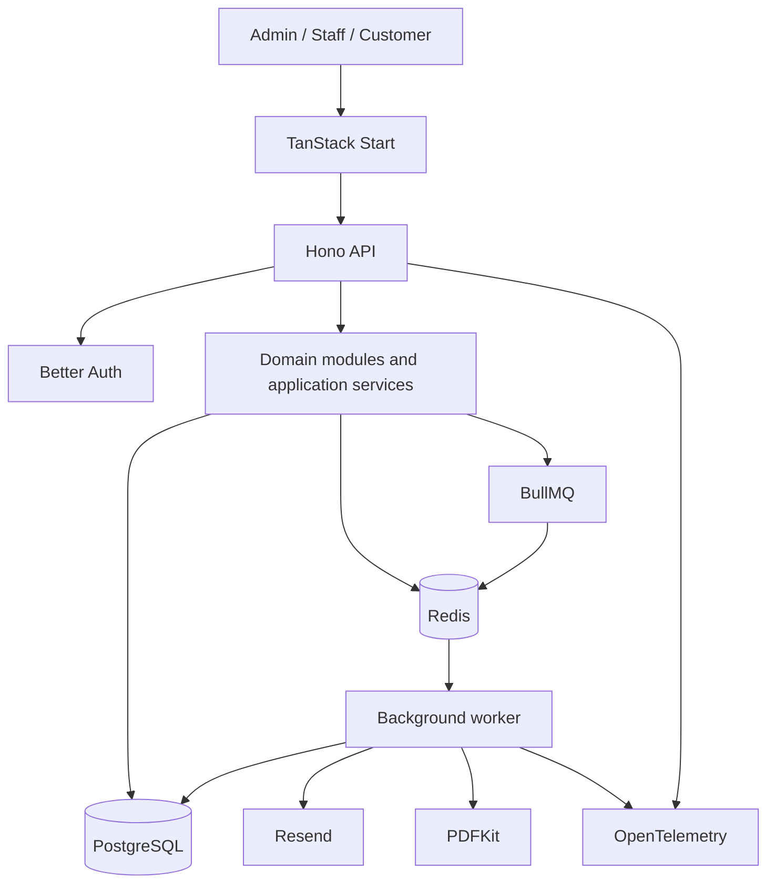

# Subscription Management System

> **Project handoff / source of truth for the documentation-vault agent**
>
> This README defines the current product scope, approved technology direction, architectural principles, and documentation work to complete before implementation. Treat confirmed decisions as constraints. Treat items marked **TBD** as unresolved; document the options and ask for a decision rather than silently choosing one.

## 1. Project overview

Build a subscription-management platform for **Brightloop Software**. The system replaces spreadsheet-based subscription tracking and manual billing workflows with a centralized application for managing customers, products, plans, quotations, subscriptions, invoices, discounts, payments, and financial reporting.

The application must support recurring billing, reliable invoice generation, payment tracking, and operational visibility as the number of subscriptions grows into the thousands.

### Primary goals

- Centralize subscription and customer records.
- Configure products, product variants, plans, taxes, and discounts.
- Create quotations and convert accepted quotations into subscriptions.
- Track the subscription lifecycle and renewal dates.
- Generate invoices for subscriptions due for billing.
- Record payments and calculate outstanding balances.
- Identify overdue invoices and subscriptions.
- Provide dashboards and filtered reports for operational and financial work.
- Keep the system maintainable as features and workload grow.

### Non-goals for the initial architecture

- Do not introduce microservices without a demonstrated need.
- Do not add Kafka, Kubernetes, ClickHouse, or another infrastructure platform by default.
- Do not use an LLM or agent as a runtime component of the customer-facing product. Agentic coding tools may be used to develop the system; that is separate from the product architecture.
- Do not use Redis as the authoritative store for subscriptions, invoices, payments, or other financial records.

## 2. Technology stack

The current intended stack is a TypeScript-based modular monolith with separately runnable API and background-worker processes.

| Layer | Technology | Responsibility |
|---|---|---|
| Web application | **TanStack Start** | Routing, server-rendered application, frontend experience |
| Backend API | **Hono** | Lightweight TypeScript API, middleware, routing and application-service integration |
| Primary database | **PostgreSQL** | Persistent source of truth |
| Database toolkit / ORM | **Drizzle ORM** | Typed schema, queries, migrations |
| Authentication | **Better Auth** | Authentication, sessions, password reset and related identity flows |
| Background jobs | **BullMQ** | Asynchronous and scheduled job processing |
| Queue/cache store | **Redis** | BullMQ job storage and disposable application cache |
| Validation | **Zod** | Runtime validation at API and application boundaries |
| API contract | **OpenAPI** | Documented API contract and client integration |
| Email | **Resend** | Transactional email delivery |
| PDF generation | **PDFKit** | Invoice and quotation PDF generation |
| Observability | **OpenTelemetry** | Traces, metrics and instrumentation |

### Stack integration principles

- TanStack Start communicates with the Hono API through explicitly documented API contracts.
- Hono routes handle HTTP concerns and delegate business rules to domain/application services. Do not place financial or subscription rules in route handlers or duplicate them in frontend code.
- Drizzle schema and migrations are the canonical representation of the PostgreSQL data model.
- Better Auth handles authentication. Application-level authorization and tenant/resource access checks must still be enforced by the backend.
- BullMQ workers execute slow, scheduled, retryable, or batch operations outside request-response handlers.
- PostgreSQL remains authoritative. Redis data must be safe to expire or rebuild, except for BullMQ's operational queue state.
- Zod schemas should validate external input. Avoid maintaining multiple unrelated definitions of the same API contract.
- OpenAPI documentation must reflect the actual API implementation.
- Email and PDF generation should be isolated behind services so providers or implementations can be changed without rewriting domain logic.

## 3. Architecture style

Use a **modular monolith**, not a distributed microservice architecture.

The API and worker can run as separate processes while sharing domain modules, application services, database access, and configuration. This keeps deployment and development straightforward while allowing background processing to scale independently.

### High-level architecture



The diagram is conceptual. Refine it when implementation details are decided, but preserve the core separation of responsibilities.

### Suggested backend organization

Organize the Hono API and shared application code by business domain. Keep route registration, middleware, domain logic, and infrastructure separate. A reasonable starting point:

- `auth` — Better Auth integration, session handling and authentication-related endpoints.
- `users` — user profile and account operations.
- `organizations` — tenant/business ownership and memberships, if multi-tenancy is selected.
- `customers` — customer records and contact details.
- `products` — products, variants, pricing and cost information.
- `plans` — billing intervals, plan rules and availability.
- `taxes` — tax configuration and tax calculation policy.
- `discounts` — discount rules, eligibility, limits and application.
- `quotations` — quotation creation, lifecycle and conversion.
- `subscriptions` — subscription lifecycle, line items, renewals and pauses.
- `billing` — billing-period calculation and invoice generation orchestration.
- `invoices` — invoice lifecycle, line items, totals, PDFs and delivery.
- `payments` — payment recording, allocation and outstanding balances.
- `notifications` — email and other notification orchestration.
- `reports` — dashboard metrics and financial summaries.
- `audit` — important business-action history.
- `jobs` — BullMQ queue definitions, processors, schedulers and job definitions; worker entry points may live in a separate app/process.
- `common` — shared infrastructure only; avoid turning this into a dumping ground.

Folder and module boundaries may be refined during documentation. Avoid circular dependencies. Keep Hono route handlers thin: parse and validate input, authenticate/authorize, call application services, and map results to HTTP responses. Keep domain rules in the relevant domain/application layer rather than route handlers or UI components.

## 4. Product requirements and domain scope

The following scope is derived from the supplied Subscription Management System problem statement. Preserve these requirements in the documentation. Do not silently remove or reinterpret them.

### 4.1 Users and roles

The system has three stated roles:

- **Admin** — manages system configuration and staff access.
- **Staff** — handles customer and subscription operations.
- **Customer** — accesses their own customer-facing portal and subscription information.

Requirements:

- A user account is identified by a unique email address.
- Passwords must be longer than 8 characters and contain uppercase, lowercase, and special characters.
- Users must be able to reset passwords through email.
- Only an admin can add staff users.
- Customers must only access their own permitted records.
- Backend authorization must be enforced for every protected operation; hiding UI controls is not authorization.

**TBD:** Exact permissions for each role, whether staff can invite other staff, and whether customer accounts are created through self-registration or staff invitation.

### 4.2 Products and variants

Admins/staff with permission must be able to configure products.

Product information includes:

- Name
- Product type
- Sales price
- Cost price
- Notes
- Product variants and variant-specific price adjustments

The source requirements give an example of a brand variant adding 560 to the price. Preserve the concept of configurable variant adjustments, but confirm currency and whether adjustments are fixed amounts or can also be percentages.

### 4.3 Plans

Plans must support:

- Daily, weekly, monthly, and yearly billing intervals.
- Minimum quantity.
- Available dates.
- Automatic closing rules.
- Early closing.
- Pausing.
- Renewal.

**TBD:** Exact definitions and edge-case behavior for minimum quantity, available dates, automatic close, early close, pause/resume, and renewal. Document proposed state transitions and questions for product approval.

### 4.4 Quotations

The system must support:

- Quotation templates.
- Quotation validity periods.
- Conversion of an accepted quotation into a subscription.

Document the quotation lifecycle, expiry behavior, and conversion rules. Avoid creating duplicate subscriptions when a quotation is converted more than once.

### 4.5 Subscriptions

The stated lifecycle is:

`Draft -> Quotation -> Confirmed -> Active -> Closed`

A subscription must have:

- A unique subscription number.
- Customer.
- Plan.
- Start and end dates.
- Payment terms.
- Subscription line items.
- Products, quantities, unit prices, taxes, and amounts.

Document permitted transitions, who can perform them, and what side effects each transition causes. In particular, distinguish a subscription's lifecycle from an invoice's lifecycle.

### 4.6 Billing and invoices

The system must support bulk billing when many subscriptions become due on the same billing day.

Requirements:

- Automatically generate invoices for subscriptions due for billing.
- Calculate applicable taxes.
- Avoid duplicate invoices for the same subscription and billing period.
- Avoid skipping a billing period.
- Support invoice states: `Draft -> Confirmed -> Paid`.
- Support confirming, cancelling, sending, and printing invoices.
- Track invoice totals and payment status.

Document billing-period calculation, timezone policy, retry behavior, partial failure handling, and the relationship between subscription billing dates and invoice dates.

### 4.7 Discounts

Discounts may be fixed-amount or percentage-based.

Rules may include:

- Minimum purchase amount.
- Minimum quantity.
- Start and end dates.
- Usage limits.
- Product or subscription applicability.
- Automatic application to the next invoice.
- Expiry or stopping when the usage limit is reached.

Document how discounts are selected, stacked or excluded, consumed, and represented on invoice lines. **TBD:** Whether multiple discounts can apply to one invoice and the order of operations.

### 4.8 Payments and outstanding balances

The system must allow staff to record payments against invoices.

A payment record includes:

- Payment method.
- Amount.
- Date.
- Note.

The system must show:

- Amount paid.
- Outstanding amount.
- Overdue invoices requiring follow-up.

**TBD:** Whether the initial release integrates with a payment gateway or only records externally received payments. Do not assume gateway integration is required.

### 4.9 Dashboard and reporting

Provide a finance/operations dashboard with:

- Active subscriptions.
- Revenue.
- Amount owed.
- Overdue invoices.
- Useful filters and summary views.

The problem statement specifies support for thousands of subscriptions and page loads under two seconds. Treat this as a performance target to validate, not as a guarantee.

## 5. Data and financial correctness principles

Financial and subscription data require stronger consistency guarantees than ordinary cached UI data.

### Database rules

- PostgreSQL is the source of truth for all durable business records.
- Use database transactions for multi-record financial and lifecycle operations.
- Add foreign keys, unique constraints, check constraints, and indexes where they enforce domain invariants.
- Use migrations committed to version control. Do not rely on manually editing production databases.
- Use soft deletion only where justified. Financial records and audit history should not disappear through casual deletion.
- Define a consistent timestamp and timezone policy. Store timestamps consistently (normally UTC) and retain the business timezone where local billing rules require it.

### Money and tax

- Never use JavaScript floating-point numbers for monetary calculations.
- Choose and document one storage strategy: PostgreSQL `NUMERIC` with a deliberate precision/scale, or integer minor units. Be consistent.
- Use decimal-safe arithmetic in application code.
- Define currency at the appropriate business/customer/document level.
- Store sufficient invoice-line and tax snapshots so historical invoices remain reproducible even if product prices or tax configuration later changes.
- Define rounding rules explicitly, including whether rounding occurs per line or at invoice total.
- Keep tax and discount calculations in shared backend domain services.

### Idempotency and duplicate prevention

Background jobs and API requests may be retried. Every operation that creates invoices, records payments, converts quotations, or advances billing periods must be designed to be idempotent.

Examples of safeguards to document and implement:

- A unique billing identity for a subscription and billing period.
- Idempotency keys for externally retried operations where appropriate.
- Database constraints as the final protection against duplicate records.
- A job may run more than once without creating duplicate invoices or sending duplicate business effects.
- Payment recording must not silently apply the same payment twice.

Do not rely only on checking Redis or checking in application code before inserting. Enforce critical uniqueness in PostgreSQL.

## 6. Background processing with BullMQ

Use BullMQ for work that should not block an API request or that must run on a schedule.

Likely job categories:

- Find subscriptions due for billing.
- Generate invoices in batches.
- Send invoice and quotation emails.
- Generate invoice/quotation PDFs.
- Send payment reminders for overdue invoices.
- Process subscription renewal and expiry events.
- Recompute dashboard/reporting aggregates when appropriate.

### Queue design principles

- Keep job payloads small. Prefer database IDs and retrieve authoritative data from PostgreSQL inside the worker.
- Make processors idempotent.
- Configure bounded retries and exponential backoff for transient failures.
- Separate permanent business errors from transient infrastructure errors.
- Record job outcomes and expose failed jobs for operational review.
- Avoid placing sensitive customer or payment data in job payloads or logs.
- Use concurrency limits and batch sizes deliberately.
- Use scheduled/repeatable jobs for recurring billing scans and reminders; document the scheduler strategy and ensure it cannot create duplicate billing.
- Do not assume a job runs exactly once. Design for at-least-once execution.

### Redis separation

Redis serves two purposes initially:

1. BullMQ queue state and job coordination.
2. Disposable application caching.

Keep queue keys and cache keys in separate namespaces. Use separate Redis connections/configuration for queue and cache clients where required by BullMQ and the cache library. Do not allow cache eviction policy to evict BullMQ job data; use a queue-safe Redis configuration (commonly `noeviction`) and monitor memory. If cache and queue workloads begin competing for resources, split them into separate Redis instances.

Redis cache entries must be rebuildable from PostgreSQL. Never treat a cached balance, invoice status, or subscription state as authoritative.

### Caching guidance

Potential cache candidates:

- Dashboard summaries.
- Frequently read product/plan configuration.
- Read-heavy reference data.

Use tenant/business-scoped cache keys if multi-tenancy is enabled, for example:

```text
org:{organizationId}:dashboard:summary
org:{organizationId}:products:list:{queryHash}
```

Define TTLs and invalidation rules. Invalidate or refresh affected cache entries after successful database commits. Do not cache sensitive customer data without a clear need and access-control strategy.

## 7. API and validation conventions

- Use versioned API routes, such as `/api/v1/...`, unless a documented alternative is selected.
- Use consistent response and error formats.
- Validate request bodies, query parameters, and path parameters at the boundary with Zod.
- Validate authorization and ownership on the server for every resource access.
- Use pagination for collection endpoints. Prefer cursor pagination for large or frequently changing datasets where appropriate.
- Apply filtering and sorting in PostgreSQL rather than fetching entire collections into application memory.
- Avoid N+1 query patterns.
- Generate and maintain OpenAPI documentation from the implemented API contract.
- Do not expose internal stack traces, secrets, or database details to clients.
- Add rate limits to sensitive endpoints such as login, password reset, and invitation flows.

**TBD:** REST conventions, pagination format, API versioning policy, error envelope, and whether the OpenAPI document is generated from Hono/Zod integration or maintained through another contract-first approach.

## 8. Authentication, authorization, and tenancy

### Authentication

Use Better Auth for authentication and session management, integrated with the Hono application. Document:

- Better Auth integration with the Hono application.
- Drizzle adapter configuration.
- Session lifecycle and cookie/security settings.
- Password reset email flow through Resend.
- Account creation and invitation rules.
- Development and production callback/origin configuration.

Mount or adapt Better Auth's request handler through the Hono app using the supported integration pattern. Keep authentication/session verification and application authorization explicit. Do not assume Better Auth alone implements all business authorization rules.

### Authorization

Implement server-side role and resource authorization. At minimum:

- Admin-only staff creation.
- Staff access according to an explicit permission matrix.
- Customer access restricted to their own records.
- Sensitive financial operations restricted to authorized roles.
- Authorization checks must apply to API endpoints, background jobs, and document-download routes.

### Tenancy decision is unresolved

The supplied problem statement describes one business, Brightloop Software. A multi-tenant SaaS model has been discussed, but it has **not been confirmed as a requirement**.

Document both options and request a decision:

- **Single-business deployment:** one Brightloop business, with roles and ownership scoped to that business.
- **Multi-tenant SaaS:** multiple organizations share the application and database, with tenant-owned rows carrying an `organization_id` (or equivalent), strict tenant isolation, organization membership, and tenant-scoped cache keys.

Do not implement multi-tenancy merely because it is technically possible. Do not omit tenant isolation if the product is confirmed to serve multiple businesses. The schema and authorization design depend on this decision.

## 9. Performance and scalability

The initial target is thousands of subscriptions with page loads under two seconds.

Start with sound relational design and measurement:

- Index foreign keys and common filters/sorts.
- Design indexes around real query patterns, not every column.
- Paginate large lists.
- Use database-side aggregation for dashboard metrics.
- Avoid loading full subscription histories for summary pages.
- Use connection pooling appropriate to the deployment environment.
- Keep long-running work in BullMQ workers.
- Use caching for measured read-heavy bottlenecks.
- Instrument API latency, database query duration, queue wait time, job duration, and error rates with OpenTelemetry.
- Load-test billing batches and dashboard queries with realistic data volumes.
- Consider materialized views or maintained aggregate tables if reporting queries become expensive.
- Scale API and worker processes independently before considering service decomposition.

Do not add read replicas, a separate analytics database, or a distributed architecture until measurements justify them.

## 10. Security and operational requirements

- Keep secrets in environment variables or a secrets manager; never commit `.env` files.
- Provide a committed `.env.example` containing names and safe placeholders only.
- Use secure, HTTP-only, appropriately scoped cookies in production.
- Enforce HTTPS in production.
- Apply least-privilege database and infrastructure credentials.
- Validate uploads and generated/downloaded document access if file storage is introduced.
- Do not log passwords, session tokens, secrets, or full sensitive payment details.
- Add audit records for important actions such as subscription state changes, invoice confirmation/cancellation, payment recording, discount changes, and staff access changes.
- Define backup and restore procedures for PostgreSQL.
- Define Redis persistence/recovery expectations for BullMQ separately from PostgreSQL backup policy.
- Provide health/readiness checks for API, database, Redis, and workers.
- Handle graceful shutdown so workers stop accepting new work and finish or safely release active jobs.

## 11. Suggested repository layout

This is a starting proposal, not a mandatory exact structure. Adapt it to the chosen package manager and deployment model.

```text
subscription-management/
├── apps/
│   ├── web/                 # TanStack Start application
│   ├── api/                 # Hono HTTP API
│   └── worker/              # BullMQ worker entry point (separately runnable process)
├── packages/
│   ├── db/                  # Drizzle schema, migrations, database client
│   ├── contracts/            # Shared Zod schemas and API types
│   ├── config/               # Shared lint, TypeScript and runtime config
│   └── domain/               # Domain types and application services, if shared across API/workers
├── docs/                     # Documentation vault
├── scripts/
├── .env.example
├── README.md
└── package.json
```

Avoid sharing backend implementation details directly with the browser. Shared packages should contain safe contracts and types, not privileged database clients or secrets.

## 12. Documentation-vault creation instructions

The first coding-agent task is to create a useful, navigable documentation vault **before implementing application features**.

### Required outputs

Create the following documents under `docs/`:

```text
docs/
├── README.md
├── 00-project/
│   ├── project-overview.md
│   ├── goals-and-non-goals.md
│   ├── requirements-traceability.md
│   └── glossary.md
├── 01-architecture/
│   ├── system-overview.md
│   ├── architecture-decisions.md
│   ├── component-architecture.md
│   ├── data-flow.md
│   ├── deployment-architecture.md
│   └── scalability-and-performance.md
├── 02-stack/
│   ├── technology-stack.md
│   ├── frontend-tanstack-start.md
│   ├── backend-hono.md
│   ├── database-postgresql-drizzle.md
│   ├── authentication-better-auth.md
│   ├── jobs-bullmq-redis.md
│   ├── validation-zod.md
│   ├── api-openapi.md
│   ├── email-resend.md
│   ├── pdf-pdfkit.md
│   └── observability-opentelemetry.md
├── 03-domain/
│   ├── domain-model.md
│   ├── users-and-roles.md
│   ├── customers.md
│   ├── products-and-variants.md
│   ├── plans.md
│   ├── quotations.md
│   ├── subscriptions.md
│   ├── billing-and-invoices.md
│   ├── taxes-and-discounts.md
│   ├── payments.md
│   └── reporting.md
├── 04-data/
│   ├── database-design.md
│   ├── entity-relationship-diagram.md
│   ├── data-integrity-and-transactions.md
│   ├── money-and-tax-handling.md
│   └── indexing-and-query-strategy.md
├── 05-api/
│   ├── api-conventions.md
│   ├── authentication-and-authorization.md
│   └── endpoint-catalog.md
├── 06-jobs/
│   ├── queue-architecture.md
│   ├── job-catalog.md
│   ├── retry-and-idempotency.md
│   └── billing-scheduler.md
├── 07-security-operations/
│   ├── security-baseline.md
│   ├── environment-configuration.md
│   ├── logging-and-monitoring.md
│   ├── backup-and-recovery.md
│   └── deployment-and-runbooks.md
├── 08-development/
│   ├── local-development.md
│   ├── coding-conventions.md
│   ├── testing-strategy.md
│   └── agent-workflow.md
└── 09-decisions/
    ├── README.md
    └── adr-template.md
```

### Documentation quality requirements

1. Read the supplied problem statement and requirements file before writing documentation. Use them as the source for product requirements.
2. Preserve source requirements accurately. Create a requirements traceability table mapping each requirement to the relevant domain document and, later, implementation/test location.
3. Clearly label each statement as one of:
   - **Confirmed** — explicitly specified or decided.
   - **Proposed** — a recommended design that still needs approval.
   - **TBD** — information is missing or a decision is required.
4. Do not invent business rules, tax rules, payment gateway behavior, currencies, legal requirements, or deployment providers.
5. Record architectural choices as Architecture Decision Records (ADRs), including context, decision, alternatives, consequences, and status.
6. Include Mermaid diagrams where they improve understanding: system context, component architecture, ER diagram, subscription lifecycle, invoice lifecycle, billing sequence, and background-job flow.
7. Include examples only when clearly marked as illustrative. Never present sample values as confirmed business policy.
8. Keep documents focused and cross-link related documents with relative Markdown links.
9. Add a documentation index in `docs/README.md` with a short description of every document.
10. Keep this root README as the high-level project handoff. Put detailed explanations in the relevant documentation files.
11. Do not create a large amount of speculative documentation just to fill every filename. If a topic is not yet known, create a short page that records the known facts, open questions, and links to related pages.
12. After creating the vault, provide a concise report listing created files, unresolved decisions, and any inconsistencies found in the supplied source material.

### Initial ADRs to create

At minimum, create ADRs for:

- Hono as the HTTP API framework.
- Modular monolith with separately runnable API and worker processes.
- PostgreSQL as the authoritative data store.
- Drizzle ORM and migration ownership.
- Better Auth for authentication.
- BullMQ with Redis for background jobs.
- Redis shared initially for queues and cache, with isolation/configuration safeguards.
- Single-business versus multi-tenant deployment (record as **proposed / pending decision**, not an approved choice).
- Money representation and rounding policy (record the options and mark the final policy **TBD**).

## 13. Agent workflow and implementation discipline

The documentation-vault agent should prepare the project for subsequent coding agents.

- Read this README and the supplied source files first.
- Do not begin implementing the full application during the documentation-vault task.
- Do not overwrite or delete source files.
- Establish naming conventions and module boundaries.
- Identify shared contracts before parallel implementation begins.
- Record decisions in ADRs rather than relying on chat history.
- Keep a `docs/` index and update it when documents are added or changed.
- When a decision changes, update the relevant ADR and affected architecture/domain documents.
- Flag contradictions and missing requirements instead of guessing.
- Make the vault useful to both humans and coding agents: concise, structured, internally linked, and explicit about constraints.

For later implementation, agents should work against agreed interfaces and avoid editing the same files concurrently. A suggested work split is:

1. Database, schema, migrations, and authentication foundation.
2. Core catalog and customer domains.
3. Quotations, subscriptions, billing, invoices, discounts, and payments.
4. Frontend application and customer/staff/admin experiences.
5. Integration, tests, performance validation, and deployment.

This split is provisional and should be refined after the domain model and API contracts are documented.

## 14. Open decisions to track

The documentation agent must create and maintain an open-decisions list. At minimum:

| Decision | Current status | Why it matters |
|---|---|---|
| Single-business or multi-tenant SaaS | **TBD** | Changes data model, auth, authorization, cache keys and isolation |
| API framework | **Hono — confirmed** | Defines API routing, middleware and Better Auth integration |
| Currency and monetary storage strategy | **TBD** | Affects schema, calculations, rounding and invoices |
| Business timezone and billing cutoff rules | **TBD** | Affects recurring billing and due-date calculations |
| Tax jurisdiction and tax calculation rules | **TBD** | Affects invoice calculations and compliance |
| Payment gateway integration | **TBD** | Source requires payment recording, but does not specify gateway integration |
| Partial payments and payment allocation | **TBD** | Affects invoice balances and payment data model |
| Discount stacking and application order | **TBD** | Affects deterministic invoice totals |
| Exact plan pause, renewal, and closure semantics | **TBD** | Affects subscription state transitions |
| Deployment provider and hosting topology | **TBD** | Affects infrastructure and operational documentation |
| File/object storage for PDFs | **TBD** | PDF storage and delivery approach is not yet selected |
| API contract-generation approach | **TBD** | Affects Zod/OpenAPI integration and client generation |

## 15. Definition of done for the documentation-vault task

The initial documentation task is complete when:

- The `docs/` structure exists and is indexed.
- The product requirements have been extracted and mapped to domain areas.
- The stack and architecture are documented consistently with this README.
- Core domain entities and lifecycle diagrams are documented, with unresolved rules marked.
- Data integrity, money handling, idempotency, background jobs, caching, and authorization principles are documented.
- ADRs exist for confirmed architecture choices and unresolved decisions are explicitly pending.
- Open questions are consolidated in one place.
- The agent has not silently invented requirements or started unrelated application implementation.
- A final handoff report identifies the next recommended implementation step.

---

## Source files

The project handoff is based on the supplied:

- `Subscription_Management_System.pdf` — product/problem statement.
- `requirements.txt` — project/hackathon requirements supplied with the task.

If either source changes, review the requirements traceability document and update the affected documentation. Do not assume this README overrides a newer, explicitly approved product requirement.
