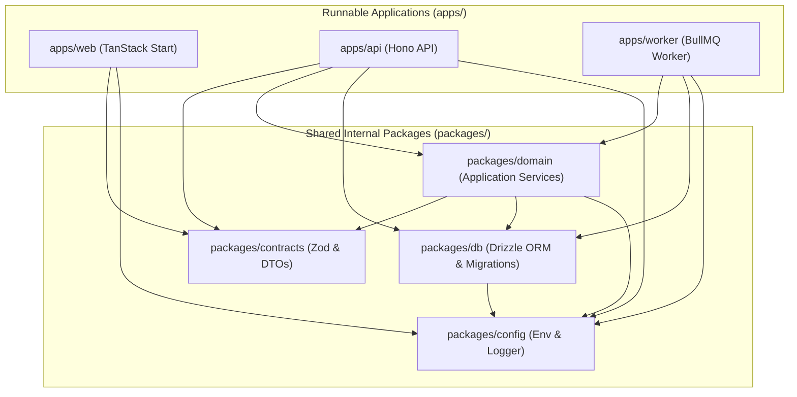

# Component Architecture

> **Status: Confirmed Component Model**
>
> Structural breakdown of workspace applications, internal shared packages, runtime boundaries, and dependency graphs.

---

## 1. Monorepo Structure

The repository is organized as a clean TypeScript monorepo managed with **pnpm workspaces**:

```text
subscription-management/
├── apps/
│   ├── web/                     # TanStack Start SSR frontend application
│   ├── api/                     # Hono HTTP API service
│   └── worker/                  # BullMQ background job worker process
├── packages/
│   ├── db/                      # Drizzle schemas, migrations, PostgreSQL client
│   ├── contracts/               # Shared Zod schemas, OpenAPI types, and DTOs
│   ├── domain/                  # Domain business logic and application services
│   └── config/                  # Shared TypeScript, ESLint, and environment configuration
├── docs/                        # Complete documentation vault
├── data/                        # Persistent local host directories (Docker mounts)
│   ├── postgres/                # PostgreSQL 16 data files
│   ├── redis/                   # Redis AOF and dump files
│   └── media/                   # Rendered PDF invoices and quotations
├── docker-compose.yml           # Production Docker Compose specification
├── docker-compose.dev.yml       # Local development Docker Compose with bind mounts
├── AGENTS.md                    # Operational directives for AI coding agents
├── README.md                    # Root executive summary and navigation
└── .gitignore                   # Workspace gitignore rules
```

---

## 2. Component Dependency Graph



---

## 3. Detailed Component Specifications

### 3.1 `apps/web` (TanStack Start)
- **Role**: Delivers the user interfaces for Admin, Staff, and Customer users.
- **Key Technologies**: TanStack Start, TanStack Router, TanStack Query, React, Tailwind CSS / Vanilla CSS.
- **Responsibilities**:
  - Full-stack SSR routing and progressive enhancement.
  - Better Auth client session handling and route protection.
  - Consumes typed API contracts from `packages/contracts`.
  - Never imports `packages/db` or internal database secrets directly.

### 3.2 `apps/api` (Hono HTTP API)
- **Role**: Lightweight, high-performance HTTP API server.
- **Key Technologies**: Hono, `@hono/zod-openapi`, Better Auth Hono adapter.
- **Responsibilities**:
  - Exposes REST endpoints prefixed with `/api/v1/`.
  - Validates request headers, query params, and bodies using Zod schemas.
  - Enforces role-based access control (Admin, Staff, Customer) and resource ownership.
  - Delegates all financial and subscription operations to `packages/domain`.
  - Emits OpenTelemetry traces on incoming requests.

### 3.3 `apps/worker` (BullMQ Background Worker)
- **Role**: Standalone Node.js process executing background tasks, batch billing, PDF rendering, and notifications.
- **Key Technologies**: BullMQ, ioredis, PDFKit, Resend SDK.
- **Responsibilities**:
  - Listens to BullMQ queues (`billing`, `invoices`, `emails`, `reports`).
  - Executes recurring billing cron jobs (`0 0 * * *` midnight run).
  - Generates immutable PDF invoices and stores them in `/app/media`.
  - Dispatches transactional emails via Resend with exponential backoff retries.

### 3.4 `packages/db` (Drizzle ORM & Migrations)
- **Role**: Canonical schema definitions, migrations, and database connection pooling.
- **Key Technologies**: PostgreSQL 16, Drizzle ORM, `drizzle-kit`, `postgres` (or `pg`).
- **Responsibilities**:
  - Defines table schemas with strict types, constraints, and indexes.
  - Houses committed database migration SQL files.
  - Exposes safe transactional client utilities (`db.transaction()`).

### 3.5 `packages/contracts` (Zod Schemas & DTOs)
- **Role**: Single source of truth for runtime validation and API types.
- **Key Technologies**: Zod, OpenAPI 3.1 specifications.
- **Responsibilities**:
  - Request body schemas, URL parameter schemas, and response DTOs.
  - Shared across `apps/web` and `apps/api` to eliminate contract drift.

### 3.6 `packages/domain` (Application Services)
- **Role**: Pure business logic, lifecycle state machines, and calculations.
- **Responsibilities**:
  - Catalog pricing calculations and variant adjustment rules.
  - Quotation-to-subscription conversion logic.
  - Tax calculation engine and discount stacking rules.
  - Payment allocation and invoice balance computation.
  - Cache invalidation coordination.

### 3.7 `packages/config` (Shared Config)
- **Role**: Centralized environment variable parsing, shared logger (Pino), and OpenTelemetry configuration.
- **Responsibilities**:
  - Parses and validates `process.env` against Zod schemas on startup.
  - Standardized JSON logging format.
