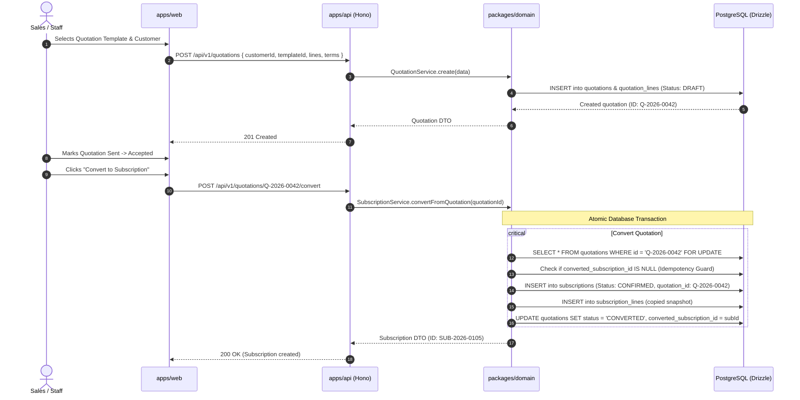
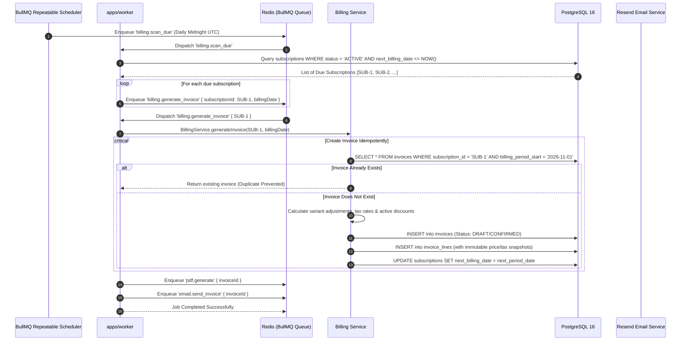
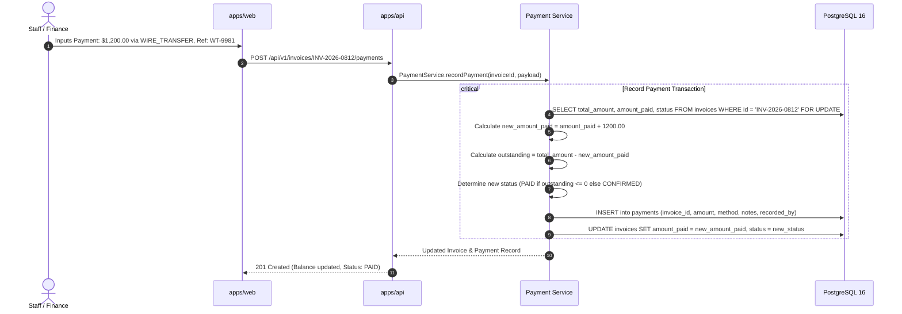
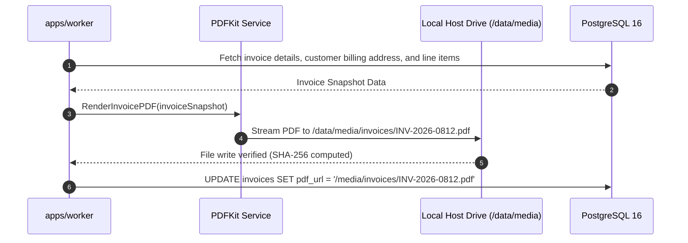

# System Data Flow & Sequence Diagrams

> **Status: Confirmed Flow Specifications**
>
> Step-by-step sequence diagrams and operational paths for core business flows within the Brightloop Subscription Management System.

---

## 1. Flow 1: Quotation Creation and Conversion to Subscription

When a sales representative creates a quotation from a template and converts it into an active subscription:

---

## 2. Flow 2: Automated Bulk Billing Run

How the system detects due subscriptions, computes taxes/discounts, and generates invoices without duplicates:

---

## 3. Flow 3: Recording Payment Against Invoice

Recording external or gateway payments and updating invoice balances:

---

## 4. Flow 4: PDF Generation and Caching Flow

