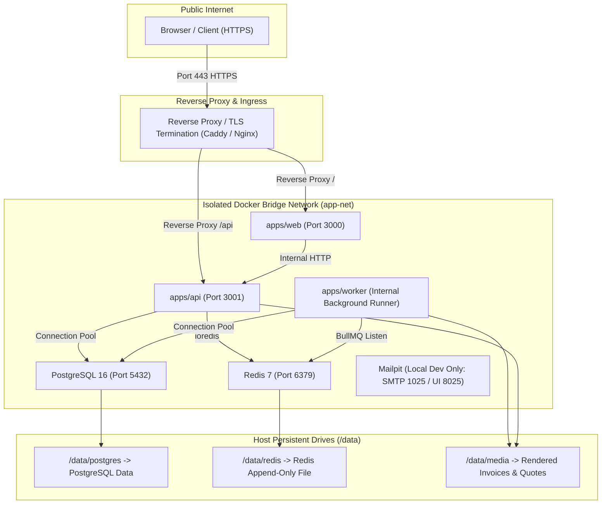

# Deployment Architecture

> **Status: Confirmed Docker-Based Topology**
>
> Container topology, network security boundaries, process execution targets, and persistent volume architectures for both local environments and production deployments.

---

## 1. Deployment Topology Overview

The Brightloop Subscription Management System is deployed as containerized workloads running on modern Linux hosts with Docker and Docker Compose. This architecture avoids unnecessary container orchestration complexity (Kubernetes) while enabling independent process scaling and isolated network boundaries.

---

## 2. Container Role & Resource Allocation

| Container Name | Base Image | Role | Port (Host / Internal) | Volume Mounts | Healthcheck |
|---|---|---|---|---|---|
| `postgres` | `postgres:16-alpine` | Authoritative relational database | `5432:5432` | `./data/postgres:/var/lib/postgresql/data` | `pg_isready -U brightloop` |
| `redis` | `redis:7-alpine` | BullMQ queues and fast application cache | `6379:6379` | `./data/redis:/data` | `redis-cli ping` |
| `api` | `node:20-alpine` | Hono HTTP REST API | `3001:3001` | `./data/media:/app/media` | `wget -qO- http://localhost:3001/api/v1/health` |
| `worker` | `node:20-alpine` | BullMQ job consumer & scheduler | None (Internal) | `./data/media:/app/media` | Process heartbeat via Redis |
| `web` | `node:20-alpine` | TanStack Start SSR frontend | `3000:3000` | None | `wget -qO- http://localhost:3000/` |
| `mailpit` *(Dev)* | `axllent/mailpit` | Local SMTP mock server & UI | `8025:8025`, `1025:1025` | Transient | Built-in |

---

## 3. Host Drive Connectivity & Mount Strategy

1. **PostgreSQL Persistent Drive**:
   - Host path: `./data/postgres` (or `/devdrive/github/projects/subscription-management/data/postgres`).
   - Container path: `/var/lib/postgresql/data`.
   - Security: Mounted with strict Linux file permissions (`uid:gid 999:999`).
2. **Redis Append-Only Persistence**:
   - Host path: `./data/redis`.
   - Container path: `/data`.
   - Config: Running with `--appendonly yes --maxmemory-policy noeviction`.
3. **Media & Document Storage**:
   - Host path: `./data/media`.
   - Container path: `/app/media`.
   - Shared between `api` and `worker` so invoices generated asynchronously by the worker are immediately downloadable via the API.

---

## 4. Scalability & Operational Scaling

- **Scaling API**: Spin up multiple replicas of `api` behind the load balancer/reverse proxy without shared state (stateless authentication via Better Auth database/cookie tokens).
- **Scaling Worker**: Spin up multiple replicas of `worker`. BullMQ automatically coordinates job concurrency across multiple workers via Redis atomics (`BRPOPLPUSH` / Redis Lua scripts).
- **Graceful Shutdown**: All Node.js processes intercept `SIGTERM` and `SIGINT`, permitting active HTTP requests and BullMQ jobs to conclude cleanly before termination.
