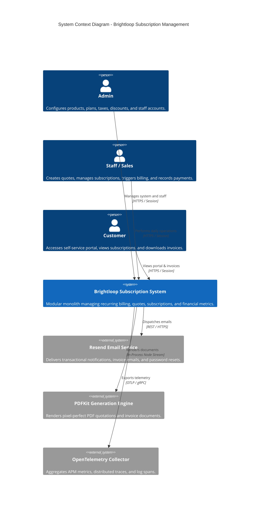
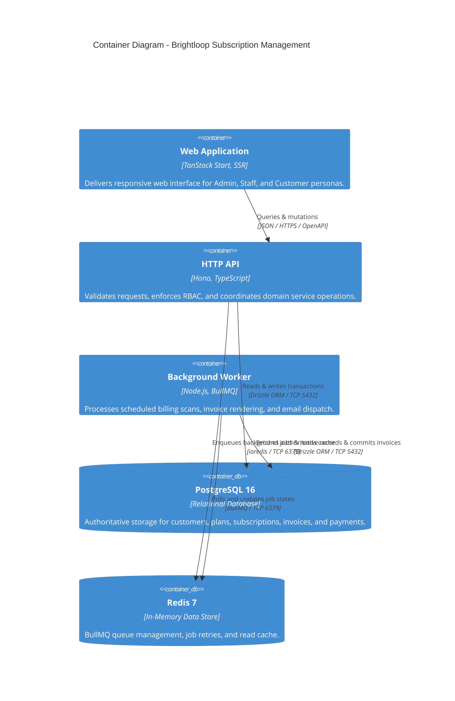

# System Overview & Architecture

> **Status: Confirmed Modular Monolith Architecture**
>
> High-level system structure, container models, boundary definitions, and separation of concerns for the Brightloop Subscription Management System.

---

## 1. Architectural Philosophy: The Modular Monolith

Rather than adopting a distributed microservice topology with its associated network latency, distributed transactions, and operational complexity, Brightloop is architected as a **TypeScript-based Modular Monolith**.

Key Characteristics:
- **Shared Domain Core**: Domain logic, financial calculation rules, validation contracts, and database models reside in strongly-typed internal packages (`packages/domain`, `packages/contracts`, `packages/db`).
- **Separately Runnable Processes**: The system is partitioned into independently executable containerized processes:
  1. `apps/web`: Server-rendered frontend experience powered by **TanStack Start**.
  2. `apps/api`: Lightweight HTTP API built with **Hono**.
  3. `apps/worker`: High-throughput asynchronous background job runner built on **BullMQ**.
- **PostgreSQL as the Durable Source of Truth**: All persistent financial, customer, and subscription states are maintained exclusively in PostgreSQL 16.
- **Redis for Coordination & Caching**: Redis 7 is utilized strictly for BullMQ queue coordination and transient, rebuildable application caching.

---

## 2. C4 Context Diagram (System in Environment)

---

## 3. C4 Container Diagram (Runtime Processes & Storage)

---

## 4. Active Prototype Runtime Model & Scale-Out Blueprint

To deliver rapid execution without premature infrastructure complexity (adhering to the Ponytail principle), the system operates across two documented stages:

### 4.1 Active Prototype Runtime (Current)
- **Frontend (`apps/web`)**: React / TanStack Start running on port `3000` with the Deslopified Industrial Precision Design Language.
- **Backend API (`apps/api`)**: Dedicated Hono HTTP service on port `3001` with Better Auth and Zod validation.
- **Automatic Billing Scheduler (`scheduler.ts`)**: In-process recurring scheduler triggering `BillingService.runBillingScan(todayStr)` periodically.
- **Distributed Concurrency Lock**: PostgreSQL transaction-level advisory locks (`pg_try_advisory_xact_lock(89214)`) guaranteeing mutual exclusion without connection-pool lock leakage.
- **PDF Engine (`pdf.ts`)**: Embedded vector PDF rendering via PDFKit serving streaming HTTP responses.

### 4.2 Scale-Out Production Blueprint (Deferred)
- **Decoupled Billing Service**: `BillingService` in `@repo/domain` is 100% independent of the transport layer and scheduler. When scaling to high-throughput clusters, BullMQ workers (`apps/worker`) invoke `BillingService.runBillingScan` without any business logic rewrites.
- **Redis Queue Store**: Redis container (`brightloop_redis_dev` on port 6379) persists BullMQ job states under high volume.
- **Email Delivery**: Automated transactional PDF dispatch via Resend.

---

## 5. Related Architecture Documents

- [component-architecture.md](component-architecture.md): Deep dive into repository applications and shared packages.
- [data-flow.md](data-flow.md): Sequence diagrams for core operational flows.
- [deployment-architecture.md](deployment-architecture.md): Docker topology and container networking.
- [scalability-and-performance.md](scalability-and-performance.md): Sub-2s latency strategy and database indexing.
