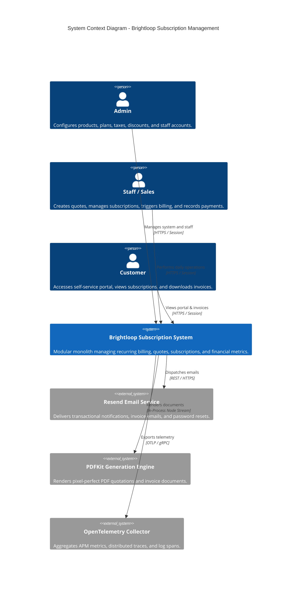
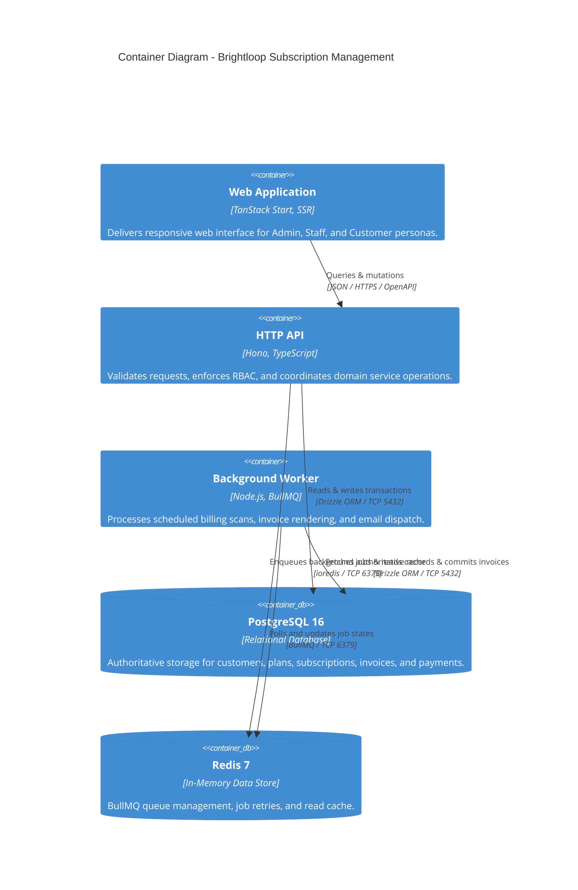

# System Overview & Architecture

> **Status: Confirmed Modular Monolith Architecture**
>
> High-level system structure, container models, boundary definitions, and separation of concerns for the Brightloop Subscription Management System.

---

## 1. Architectural Philosophy: The Modular Monolith

Rather than adopting a distributed microservice topology with its associated network latency, distributed transactions, and operational complexity, Brightloop is architected as a **TypeScript-based Modular Monolith**.

Key Characteristics:
- **Shared Domain Core**: Domain logic, financial calculation rules, validation contracts, and database models reside in strongly-typed internal packages (`packages/domain`, `packages/contracts`, `packages/db`).
- **Separately Runnable Processes**: The system is partitioned into independently executable containerized processes:
  1. `apps/web`: Server-rendered frontend experience powered by **TanStack Start**.
  2. `apps/api`: Lightweight HTTP API built with **Hono**.
  3. `apps/worker`: High-throughput asynchronous background job runner built on **BullMQ**.
- **PostgreSQL as the Durable Source of Truth**: All persistent financial, customer, and subscription states are maintained exclusively in PostgreSQL 16.
- **Redis for Coordination & Caching**: Redis 7 is utilized strictly for BullMQ queue coordination and transient, rebuildable application caching.

---

## 2. C4 Context Diagram (System in Environment)

---

## 3. C4 Container Diagram (Runtime Processes & Storage)

---

## 4. Architectural Tenets & Rules

1. **Thin HTTP Route Handlers**:
   - Handlers in `apps/api` must only validate inputs using Zod, verify authentication via Better Auth, call the appropriate application service in `packages/domain`, and format the HTTP response.
   - Financial logic, tax rules, and subscription state changes must NEVER live inside route files.
2. **Decoupled Asynchronous Execution**:
   - Heavy, slow, or retry-prone operations (e.g. bulk billing generation, PDFKit document compilation, Resend email dispatch) must always be dispatched to BullMQ queues.
   - User-facing API requests must return immediately upon enqueueing asynchronous work.
3. **Cache Invalidation Safety**:
   - Redis cache keys are ephemeral and rebuildable. If Redis is cleared, the system continues to operate correctly from PostgreSQL.
   - Cache keys for multi-record aggregates must be invalidated inside the same application service that commits the mutation.

---

## 5. Related Architecture Documents

- [component-architecture.md](component-architecture.md): Deep dive into repository applications and shared packages.
- [data-flow.md](data-flow.md): Sequence diagrams for core operational flows.
- [deployment-architecture.md](deployment-architecture.md): Docker topology and container networking.
- [scalability-and-performance.md](scalability-and-performance.md): Sub-2s latency strategy and database indexing.
