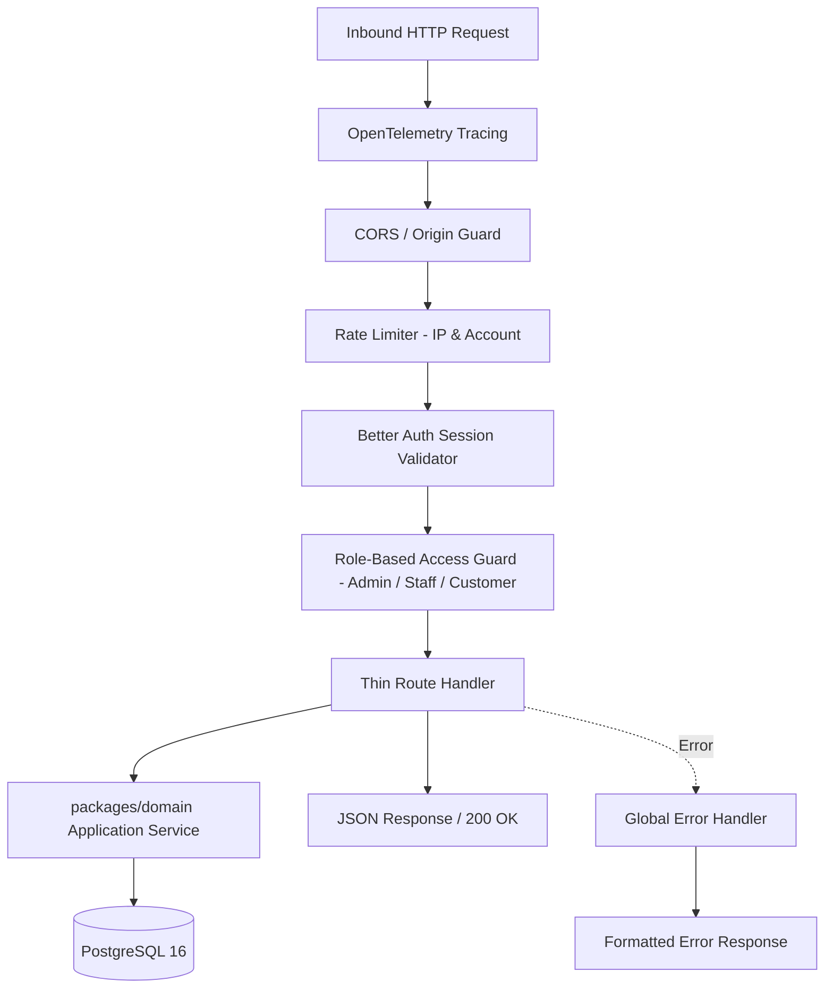

# Backend: Hono HTTP API

> **Status: Confirmed Architecture**
>
> High-performance TypeScript REST API server architecture, routing standards, and middleware pipelines for `apps/api`.

---

## 1. Role & Technology Overview

`apps/api` is built with **Hono**, a lightweight, blazing-fast web framework that provides native TypeScript inference, zero external runtime baggage, and standardized web standard request/response handling.

Key Advantages:
- **Zero Overhead**: Minimal cold start and ultra-low overhead per request.
- **`@hono/zod-openapi` Integration**: Auto-generates comprehensive OpenAPI 3.1 specifications directly from typed route schemas.
- **Thin Controller Pattern**: Route handlers remain strictly focused on HTTP concerns (headers, status codes, query extraction) while delegating business logic to `packages/domain`.

---

## 2. Directory Structure (`apps/api`)

```text
apps/api/
├── src/
│   ├── index.ts                     # Server entry point, port binding (:3001)
│   ├── app.ts                       # Hono instance configuration, global middleware
│   ├── middleware/
│   │   ├── auth.middleware.ts       # Better Auth session & role validation
│   │   ├── error.middleware.ts      # Structured JSON error formatter
│   │   ├── rate-limit.middleware.ts # In-memory / Redis rate limiting
│   │   └── otel.middleware.ts       # OpenTelemetry trace injection
│   └── routes/
│       ├── v1/
│       │   ├── auth.routes.ts       # Auth & password reset endpoints
│       │   ├── products.routes.ts   # Product & variant catalog endpoints
│       │   ├── plans.routes.ts      # Plan configuration endpoints
│       │   ├── quotations.routes.ts # Quotation generation & conversion
│       │   ├── subscriptions.routes.ts # Subscription lifecycle
│       │   ├── billing.routes.ts    # Billing run triggers & reviews
│       │   ├── invoices.routes.ts   # Invoice management & PDF download
│       │   ├── payments.routes.ts   # Payment recording endpoints
│       │   ├── reports.routes.ts    # Dashboard aggregation endpoints
│       │   └── health.routes.ts     # Liveness & readiness probes
├── package.json
└── tsconfig.json
```

---

## 3. Middleware Pipeline



---

## 4. Thin Handler Convention

Every route handler must adhere to this concise structure:
```typescript
import { createRoute, OpenAPIHono } from '@hono/zod-openapi';
import { CreateProductSchema, ProductResponseSchema } from '@repo/contracts';
import { ProductService } from '@repo/domain';

const route = createRoute({
  method: 'post',
  path: '/api/v1/products',
  request: { body: { content: { 'application/json': { schema: CreateProductSchema } } } },
  responses: {
    201: { content: { 'application/json': { schema: ProductResponseSchema } }, description: 'Product created' }
  }
});

// Handler delegates immediately to domain service
app.openapi(route, async (c) => {
  const body = c.req.valid('json');
  const user = c.get('user');
  const product = await ProductService.createProduct(body, user.id);
  return c.json(product, 201);
});
```
