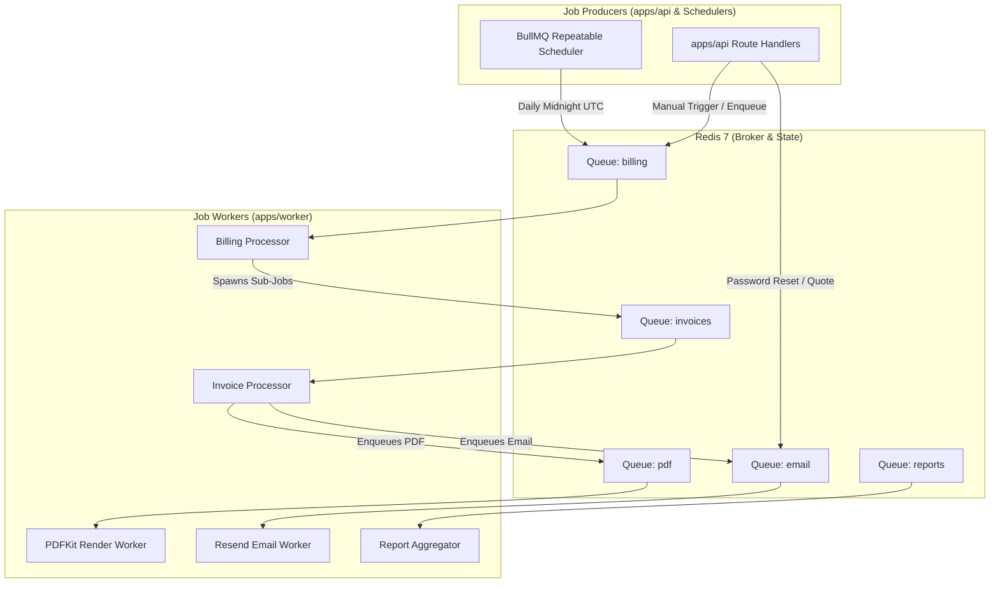

# Jobs & Background Processing: BullMQ & Redis

> **Status: Confirmed Architecture**
>
> Asynchronous job queues, scheduled recurring billing runs, worker process lifecycle, and Redis configuration safeguards.

---

## 1. Role & Technology Overview

**BullMQ** backed by **Redis 7** manages all asynchronous background tasks, batch billing calculations, PDFKit invoice generation, email dispatch, and overdue invoice reminders.

Key Operational Guarantees:
- **At-Least-Once Execution**: Jobs are designed to be idempotent; re-running a job must not duplicate invoices or financial records.
- **Queue vs Cache Separation**: Redis keys for BullMQ (prefixed with `bull:*`) are isolated from application cache keys (`cache:*`).
- **Noeviction Policy**: Redis is configured with `--maxmemory-policy noeviction` to ensure pending background jobs are never dropped under memory pressure.

---

## 2. Queue Topology



---

## 3. Worker Implementation Pattern

Workers in `apps/worker` follow strict error-handling and backoff patterns:

```typescript
import { Worker, Job } from 'bullmq';
import { redisConnection } from '@repo/config';
import { BillingService } from '@repo/domain';

export const billingWorker = new Worker(
  'billing',
  async (job: Job) => {
    switch (job.name) {
      case 'scan_due_subscriptions':
        return await BillingService.scanAndEnqueueDueSubscriptions(job.data.billingDate);
      case 'generate_subscription_invoice':
        return await BillingService.processSubscriptionBilling(job.data.subscriptionId, job.data.billingPeriod);
      default:
        throw new Error(`Unknown job name: ${job.name}`);
    }
  },
  {
    connection: redisConnection,
    concurrency: 5,
    limiter: { max: 50, duration: 1000 }
  }
);
```

---

## 4. Job Options & Retry Strategy

All background jobs define bounded retries with exponential backoff:

```typescript
export const defaultJobOptions = {
  attempts: 5,
  backoff: {
    type: 'exponential',
    delay: 2000 // 2s, 4s, 8s, 16s, 32s
  },
  removeOnComplete: { count: 1000 },
  removeOnFail: { count: 5000 }
};
```
