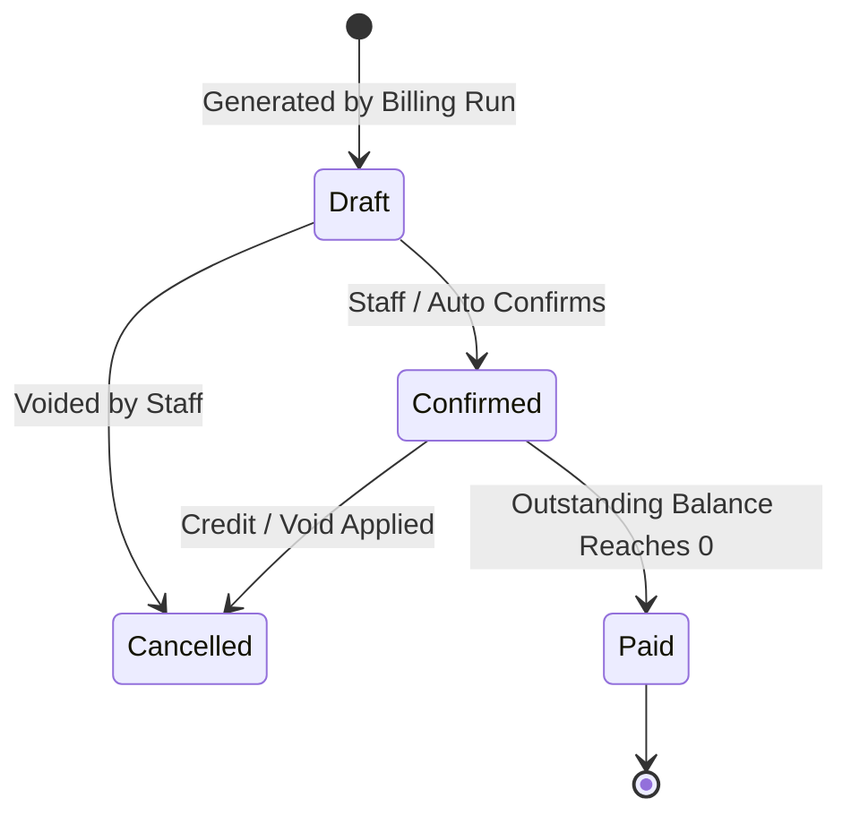

# Billing & Invoices

> **Status: Confirmed Domain Specification**
>
> Automated bulk billing execution, duplicate prevention safeguards, invoice lifecycle, tax calculation, and document delivery.

---

## 1. Automated Bulk Billing Day

As described in Scene 4 of the problem statement:
> *"It is billing day, and hundreds of subscriptions are due at once. Nobody should be typing invoices by hand. Each one should be created from its subscription, with the customer details, product lines, taxes and totals already filled in."*

### Billing Run Execution Algorithm
1. **Trigger**: Initiated daily at midnight UTC via BullMQ repeatable scheduler or triggered on-demand by staff (`POST /api/v1/billing/trigger`).
2. **Detection Query**:
   ```sql
   SELECT id, customer_id, plan_id, next_billing_date 
   FROM subscriptions 
   WHERE status = 'ACTIVE' 
     AND next_billing_date <= CURRENT_DATE;
   ```
3. **Chunking**: Subscriptions are divided into BullMQ worker batches of 100 items.
4. **Idempotency Safeguard**: Each invoice generation checks for an existing invoice matching `(subscription_id, billing_period_start)`. If found, invoice generation is bypassed without throwing an error.

---

## 2. Invoice Lifecycle State Machine

$$\text{Draft} \longrightarrow \text{Confirmed} \longrightarrow \text{Paid}$$



### Invoice State Rules:
- **Draft**: Lines and amounts are computed. Edits or line adjustments are allowed.
- **Confirmed**: The invoice is posted to the customer's account. Line items and amounts become immutable. The balance is active and can receive payments. A PDF is generated and an email notification is dispatched.
- **Paid**: Recorded payments equal or exceed `total_amount`. Outstanding balance is 0.
- **Cancelled**: The invoice is voided; it is excluded from revenue calculations and cannot receive further payments.

---

## 3. Invoice Calculation & Snapshot Storage

When generating an invoice:
1. Copy product names, variant names, and prices into immutable snapshot fields on `invoice_lines`.
2. Evaluate active discount rules and calculate deductions.
3. Compute applicable tax rules.
4. Advance the subscription's `next_billing_date` by the plan interval.
5. Store totals using decimal arithmetic:
   $$\text{Total Amount} = \text{Subtotal} - \text{Discount Amount} + \text{Tax Amount}$$
