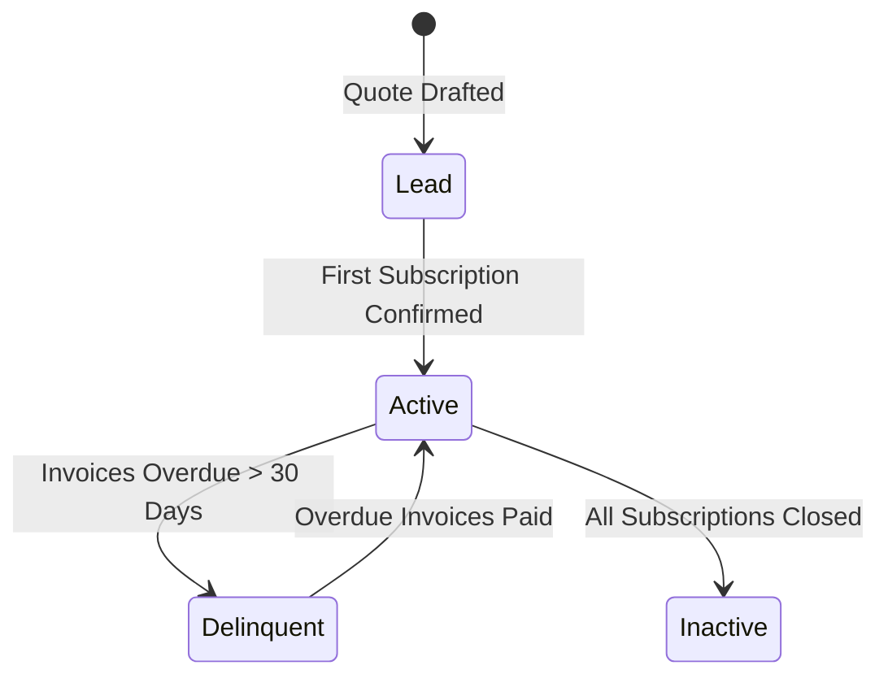

# Customers & Contacts

> **Status: Confirmed Domain Specification**
>
> Customer entity models, billing addresses, contacts, and account management.

---

## 1. Domain Overview

A **Customer** represents a client business or individual subscriber purchasing software subscriptions from Brightloop Software.

### Customer Attributes
- `id`: Unique UUID identifier.
- `company_name`: Business name or trading entity.
- `contact_name`: Primary person managing the account.
- `email`: Primary billing and notification email address (unique).
- `phone`: Contact telephone number.
- `tax_identifier`: VAT/GST or tax registration number (optional).
- `billing_address`: Street, city, state/province, postal code, and country code.
- `currency`: Default billing currency (default: `USD`).
- `payment_terms`: Default credit window (e.g. `NET_0` - Due upon receipt, `NET_15`, `NET_30`).
- `created_at` / `updated_at`: Audit timestamps.

---

## 2. Customer Lifecycle & Invariants

1. **Address Snapshots**: When an invoice is created, the customer's current billing address and tax identifier are copied into an immutable `invoice_customer_snapshot` jsonb column on the invoice, ensuring that historical tax compliance remains unaffected by future address updates.
2. **Deletion Safeguards**: Customers with confirmed subscriptions, invoices, or recorded payments cannot be hard-deleted from PostgreSQL. Soft-deactivation is used instead.
