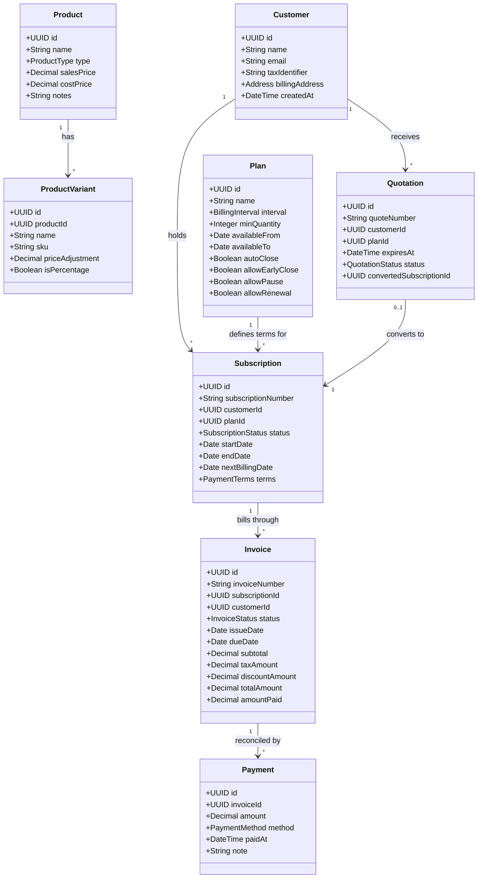

# Domain Model & Aggregate Boundaries

> **Status: Confirmed Domain Architecture**
>
> High-level domain structure, aggregate boundaries, entity definitions, and business invariants for Brightloop Subscription Management.

---

## 1. Domain Entities & Aggregate Map

The domain is organized into distinct aggregates where transactions preserve business invariants:

---

## 2. Core Domain Invariants

1. **Email Uniqueness**: Every user and customer primary contact must have a distinct, validated email address.
2. **Immutable Financial History**: Confirmed invoices and executed payments can never be updated or deleted directly; reversals require credit notes or cancellation status.
3. **Deterministic Rounding**: All tax, discount, and line calculations must be computed using fixed decimal arithmetic and rounded to 2 decimal places at the invoice total level.
4. **Idempotent Billing**: A subscription cannot have two invoices for overlapping billing intervals.
5. **Quotation Conversion Guarantee**: An accepted quotation can only be converted into a subscription once. Subsequent conversion attempts must return the existing subscription.
