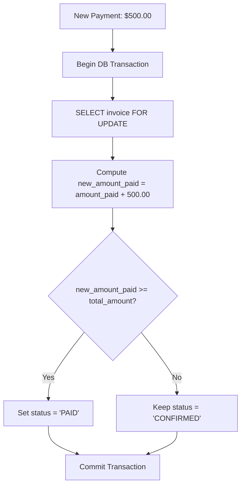

# Payments & Accounts Receivable

> **Status: Confirmed Domain Specification**
>
> Multi-method payment recording, balance reconciliation, partial payment allocation, and overdue invoice tracking.

---

## 1. Domain Overview

As specified in Scene 6 of the problem statement:
> *"Payments arrive by different methods and on different days. Each one needs to be recorded with its method, amount, date and a note, against the right invoice. At any moment, the team should be able to see which invoices are paid and which are still outstanding, so overdue ones can be chased before they turn into lost revenue."*

---

## 2. Payment Data Model

A **Payment** records funds received and allocated to an invoice:
- `id`: Unique UUID.
- `invoice_id`: Reference to target Invoice.
- `amount`: Monetary value paid (must be greater than 0).
- `payment_method`: Method used:
  - `WIRE_TRANSFER`
  - `CREDIT_CARD`
  - `BANK_DEBIT`
  - `CHECK`
  - `CASH`
  - `OTHER`
- `payment_date`: Date payment was settled/received.
- `notes`: Reference numbers, bank transaction IDs, or staff comments.
- `recorded_by`: User ID of staff member logging the transaction.
- `created_at`: Audit timestamp.

---

## 3. Balance Reconciliation & Overdue Logic

### Overdue Invoices
An invoice is classified as **Overdue** if:
1. `invoices.status == 'CONFIRMED'`
2. `(invoices.total_amount - invoices.amount_paid) > 0`
3. `invoices.due_date < CURRENT_DATE`

The dashboard highlights overdue invoices with color-coded aging buckets (1-15 days, 16-30 days, 30+ days).
