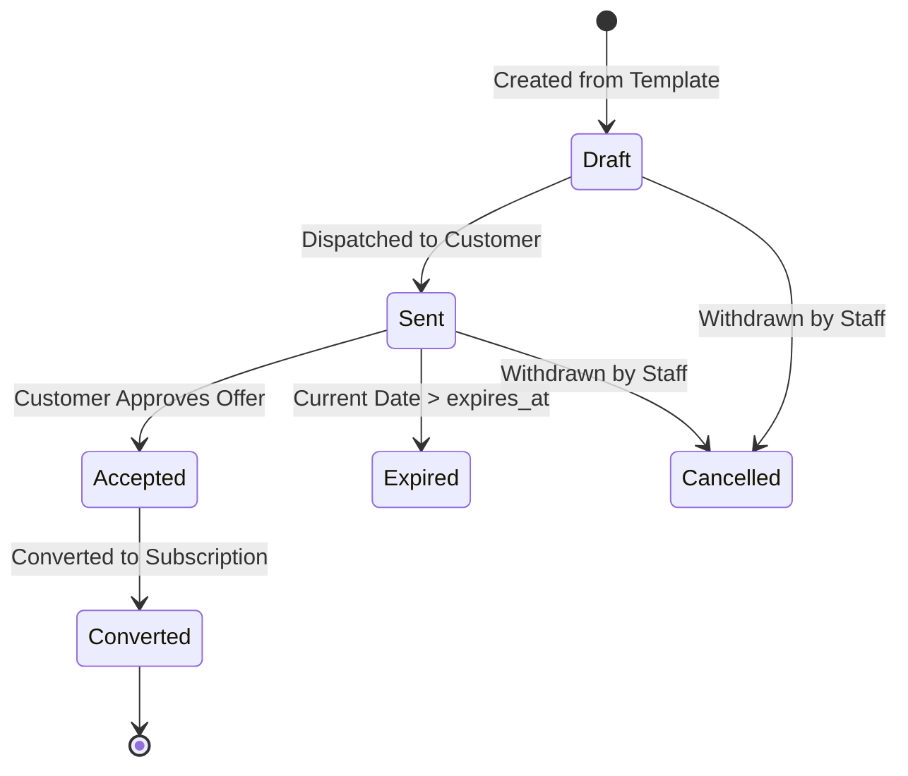

# Quotations & Quotation Templates

> **Status: Confirmed Domain Specification**
>
> Template-driven quote generation, validity windows, and idempotent conversion into active subscriptions.

---

## 1. Domain Overview

Sales representatives prepare commercial offers using **Quotations** (Scene 3). To avoid building proposals from scratch every time, reps instantiate offers from pre-configured **Quotation Templates**.

---

## 2. Quotation Templates

A Quotation Template packages predefined commercial parameters:
- `id`: Unique UUID.
- `name`: Template label (e.g., "Standard Enterprise Onboarding", "Monthly SaaS Bundle").
- `default_plan_id`: Default recurring plan applied.
- `validity_days`: Number of days the generated quotation remains valid (e.g. 15 or 30 days).
- `payment_terms`: Default credit window (`NET_0`, `NET_15`, `NET_30`).
- `lines`: Preset product items, default quantities, and pre-selected variants.

---

## 3. Quotation Lifecycle & State Machine

### Conversion Guarantee (Zero-Duplication Rule)
When staff triggers `POST /api/v1/quotations/:id/convert`:
1. The system acquires a row lock on the quotation (`FOR UPDATE`).
2. It verifies that `status == 'ACCEPTED'` and `converted_subscription_id IS NULL`.
3. If already converted, it immediately returns HTTP 200 with the existing subscription ID, guaranteeing idempotency.
4. If valid, an atomic transaction inserts the new subscription and its line items, updating the quotation status to `CONVERTED` and setting `converted_subscription_id`.
