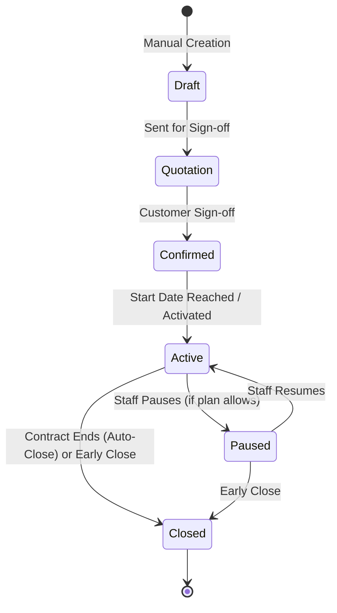

# Subscriptions & Lifecycle

> **Status: Confirmed Domain Specification**
>
> Subscription aggregate models, line items, state machines, pause/resume mechanisms, and renewal policies.

---

## 1. Subscription Structure

A **Subscription** represents an active contractual recurring billing relationship between Brightloop Software and a Customer.

### Key Attributes
- `id`: Unique UUID identifier.
- `subscription_number`: Unique sequential human-readable identifier (e.g. `SUB-2026-0001`).
- `customer_id`: Foreign key reference to `customers`.
- `plan_id`: Foreign key reference to `plans`.
- `quotation_id`: Optional reference to the quotation from which it was generated.
- `status`: Current lifecycle state (`DRAFT`, `QUOTATION`, `CONFIRMED`, `ACTIVE`, `PAUSED`, `CLOSED`).
- `start_date`: Date service commences.
- `end_date`: Optional expiration or contract end date.
- `next_billing_date`: Date the next invoice is scheduled to be generated.
- `payment_terms`: Credit terms (e.g. `NET_0`, `NET_15`, `NET_30`).
- `notes`: Operational or customer-specific notes.

### Subscription Line Items (`subscription_lines`)
Each subscription contains one or more line items:
- `product_id`: Reference to product.
- `variant_id`: Optional reference to selected product variant.
- `quantity`: Number of units/seats (must satisfy `plan.min_quantity`).
- `unit_price`: Base price plus variant adjustment.
- `tax_id`: Applicable tax rule.
- `discount_id`: Applicable discount rule.

---

## 2. Subscription Lifecycle State Machine

As defined in the source problem statement:
$$\text{Draft} \longrightarrow \text{Quotation} \longrightarrow \text{Confirmed} \longrightarrow \text{Active} \longrightarrow \text{Closed}$$

### State Definitions & Permitted Operations:
1. **Draft**: Subscriptions being configured. Line items, quantities, and pricing can be edited freely.
2. **Quotation**: Awaiting approval.
3. **Confirmed**: Contractually agreed. Awaiting initial billing date or service start.
4. **Active**: Live subscription. Evaluated by daily batch billing runs when `next_billing_date <= CURRENT_DATE`.
5. **Paused**: Service and billing temporarily suspended. Daily billing scans skip paused subscriptions.
6. **Closed**: Contract terminated. No further invoices will be generated.
