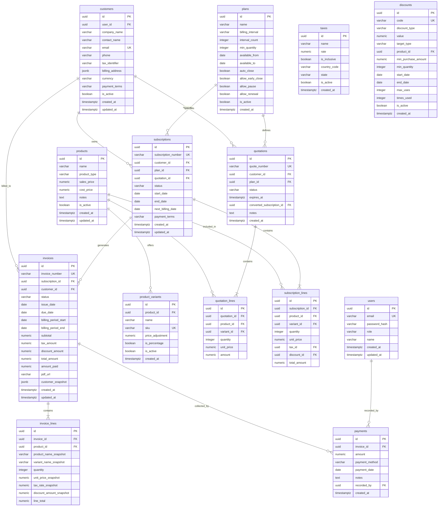

# Entity Relationship Diagram (ERD)

> **Status: Confirmed Database Schema Blueprint**
>
> Complete visual representation of all tables, fields, constraints, and relationships in `packages/db`.

---

## 1. Complete System ERD

