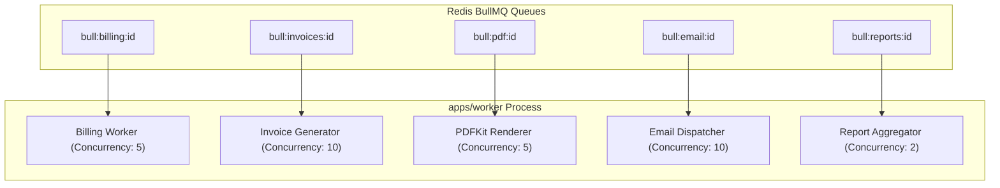

# Queue Architecture & Worker Lifecycles

> **Status: Confirmed Background Architecture**
>
> BullMQ queue topology, worker processes, Redis connection safeguards, and thread concurrency.

---

## 1. Queue Topology Overview

`apps/worker` consumes jobs from five primary BullMQ queues backed by Redis 7:

---

## 2. Worker Lifecycle & Graceful Shutdown

Workers in `apps/worker` listen for system termination signals (`SIGTERM`, `SIGINT`):
1. Upon receiving `SIGTERM`, worker calls `worker.close()` to stop fetching new jobs from Redis.
2. In-flight jobs are granted a 30-second grace period to commit their current database transaction.
3. Unfinished jobs exceeding the grace period are returned to the queue via Redis atomic locks so another worker instance can pick them up upon restart.
