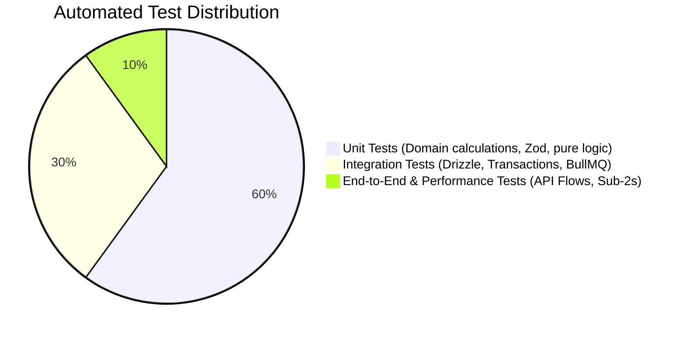

# Testing Strategy & Quality Assurance

> **Status: Confirmed Quality Standard**
>
> Automated testing pyramid, financial calculation assertions, integration test containers, and performance benchmarks.

---

## 1. Testing Pyramid

1. **Unit Tests (Fast, In-Memory)**:
   - Target: Tax calculation engine, discount stacking, prorating formulas, variant price adjustments, Zod schema validation.
   - Tool: `vitest`.
   - Execution time: < 2 seconds for full suite.
2. **Integration Tests (PostgreSQL & Redis Containers)**:
   - Target: Drizzle migrations, database constraints (`UNIQUE`, foreign keys), transaction rollbacks on payment failures, BullMQ job processing.
   - Tool: `vitest` + Docker Compose / Testcontainers.
3. **API Contract Tests**:
   - Validates that `apps/api` response payloads strictly match the declared OpenAPI 3.1 specification without field drift.
4. **Performance & Latency Benchmarks**:
   - Verifies that database queries with 10,000 seeded mock subscriptions complete within the 2-second target.

---

## 2. Mandatory Financial Unit Test Rule

In accordance with the Ponytail rule:
> *"Lazy code without its check is unfinished. Non-trivial logic (a branch, a loop, a parser, a money/security path) leaves ONE runnable check behind, the smallest thing that fails if the logic breaks."*

Every PR touching financial calculations must include targeted assert tests verifying edge cases:
- Variant adjustments with fixed vs percentage rules.
- Tax rounding with fractional cents (`0.005`).
- Multi-discount stacking order.
- Partial payment reconciliation.
