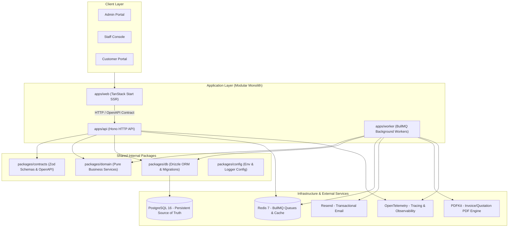

# Brightloop Subscription Management System — Documentation Vault

> **Source of Truth for Product Scope, Architecture, Domain Rules, and Operations**
>
> This vault documents the subscription management platform built for **Brightloop Software**. It provides comprehensive specifications across all architectural layers, domain boundaries, data models, API routing, job queues, security guidelines, Docker deployments, and ADRs.

---

## High-Level Architecture Overview

---

## Vault Table of Contents

| Section | Focus Area | Description |
|---|---|---|
| [**00-project/**](00-project/project-overview.md) | **Product Scope & Traceability** | Business background, verbatim problem statement, goals/non-goals, requirements traceability matrix, and glossary. |
| [**01-architecture/**](01-architecture/system-overview.md) | **System Architecture** | Modular monolith design, component breakdowns, sequence diagrams, deployment topology, and sub-2s scalability design. |
| [**02-stack/**](02-stack/technology-stack.md) | **Technology Standards** | Detailed integration blueprints for TanStack Start, Hono, PostgreSQL/Drizzle, Better Auth, BullMQ, Zod, OpenAPI, Resend, PDFKit, and OpenTelemetry. |
| [**03-domain/**](03-domain/domain-model.md) | **Domain Logic & Lifecycles** | Formal state machines and business rules for Products, Plans, Quotations, Subscriptions, Bulk Billing, Discounts, Taxes, and Payments. |
| [**04-data/**](04-data/database-design.md) | **Data Layer & ERD** | Relational schemas, complete Mermaid ERD, ACID transactions, floating-point prevention, and indexing strategy. |
| [**05-api/**](05-api/api-conventions.md) | **API & Routing Catalog** | REST conventions, Better Auth security middleware, and exhaustive endpoint catalog with payloads and responses. |
| [**06-jobs/**](06-jobs/queue-architecture.md) | **Background Queues & Jobs** | BullMQ queue topology, job catalogs, idempotent retry logic, and recurring billing scheduler. |
| [**07-security-operations/**](07-security-operations/security-baseline.md) | **Security, Ops & Docker** | OWASP baseline, environment secrets, monitoring, backup procedures, runbooks, and containerized Docker architecture. |
| [**08-development/**](08-development/local-development.md) | **Developer & Agent Guide** | Local development, drive mappings, hot reload, Ponytail coding standards, testing pyramid, and CodeGraph integration. |
| [**09-decisions/**](09-decisions/README.md) | **Architecture Decision Records** | Formal ADRs capturing confirmed technical choices and pending decisions (e.g. multi-tenancy, money representation). |

---

## Navigation & Cross-References

- **Original Problem Statement**: [problem-statement.md](00-project/problem-statement.md)
- **Requirements Traceability**: [requirements-traceability.md](00-project/requirements-traceability.md)
- **Component Architecture**: [component-architecture.md](01-architecture/component-architecture.md)
- **Complete Endpoint Catalog**: [endpoint-catalog.md](05-api/endpoint-catalog.md)
- **Entity Relationship Diagram**: [entity-relationship-diagram.md](04-data/entity-relationship-diagram.md)
- **Docker Setup & Drive Connections**: [docker-setup.md](07-security-operations/docker-setup.md)
- **Local Dev Quickstart**: [local-development.md](08-development/local-development.md)
- **Architecture Decisions**: [09-decisions/README.md](09-decisions/README.md)
