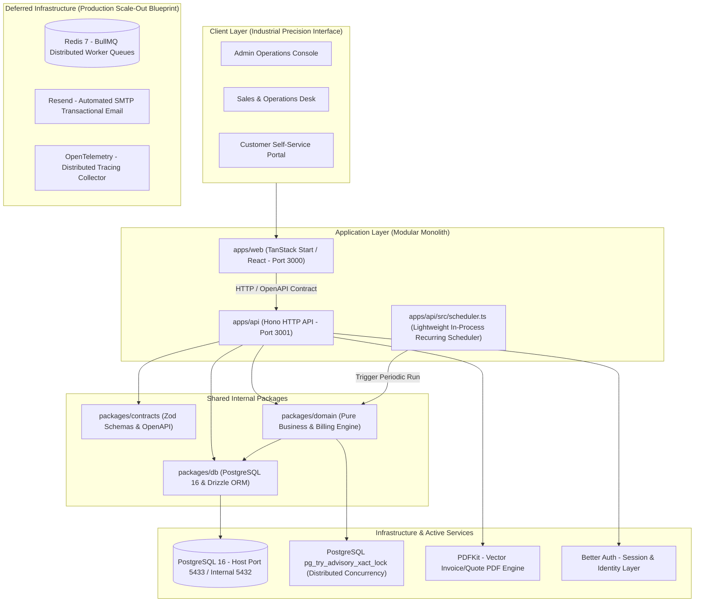

# Brightloop Subscription Management System — Documentation Vault

> **Source of Truth for Product Scope, Architecture, Domain Rules, and Operations**
>
> This vault documents the subscription management and automated recurring billing platform built for **Brightloop Software**. It provides comprehensive specifications across all architectural layers, domain boundaries, data models, API routing, job queues, security guidelines, Docker deployments, testing suites, UI design standards, and ADRs.

---

## High-Level Architecture Overview

---

## Vault Table of Contents

| Section | Focus Area | Description |
|---|---|---|
| [**00-project/**](00-project/project-overview.md) | **Product Scope & Traceability** | Business background, problem statement, goals/non-goals, confirmed implementation scope, and glossary. |
| [**01-architecture/**](01-architecture/system-overview.md) | **System Architecture** | Modular monolith design, component breakdowns, sequence diagrams, deployment topology, and sub-2s scalability. |
| [**02-stack/**](02-stack/technology-stack.md) | **Technology Standards** | Detailed integration blueprints for TanStack Start, Hono, PostgreSQL/Drizzle, Better Auth, BullMQ, Zod, and PDFKit. |
| [**03-domain/**](03-domain/domain-model.md) | **Domain Logic & Lifecycles** | Formal state machines and business rules for Products, Plans, Quotations, Subscriptions, Billing Engine, Discounts, and Taxes. |
| [**04-data/**](04-data/database-design.md) | **Data Layer & ERD** | Relational schemas, Mermaid ERD, ACID transactions, floating-point prevention (`NUMERIC(14, 4)`), and indexes. |
| [**05-api/**](05-api/api-conventions.md) | **API & Routing Catalog** | REST conventions, Better Auth security middleware, and exhaustive endpoint catalog with payloads and responses. |
| [**06-jobs/**](06-jobs/queue-architecture.md) | **Background Queues & Jobs** | In-process scheduler, BullMQ scale-out architecture, idempotent retry logic, and recurring billing scans. |
| [**07-security-operations/**](07-security-operations/security-baseline.md) | **Security, Ops & Docker** | OWASP baseline, environment secrets, monitoring, backup procedures, runbooks, and containerized Docker setup. |
| [**08-development/**](08-development/local-development.md) | **Developer & Agent Guide** | Local development, drive mappings, hot reload, Ponytail coding standards, testing pyramid, and CodeGraph integration. |
| [**09-decisions/**](09-decisions/README.md) | **Architecture Decision Records** | Formal ADRs capturing confirmed technical choices and architecture trade-offs. |
| [**10-ui-design-language/**](10-ui-design-language/README.md) | **UI Design & Deslopification** | Industrial Precision Design Language, Lufga typography, Orange/White/Black palette, and Deslopification Standard. |
| [**11-testing/**](11-testing/README.md) | **Comprehensive Test Suites** | 21 passing automated tests covering domain calculations, PostgreSQL schema constraints, and API HTTP contracts. |

---

## Active Infrastructure & Port Reference

- **Frontend Web UI**: `http://localhost:3000` (React / TanStack Start)
- **Backend Hono API**: `http://localhost:3001` (`/api/v1/*` and `/api/auth/*`)
- **PostgreSQL Database**: `localhost:5433` (mapped from Docker container port `5432`)
- **Mailpit SMTP & Web**: Port `8025` (Web UI) and `1025` (SMTP)
- **Redis Queue Store**: Port `6379` (Container persistent storage ready for BullMQ worker scale-out)
