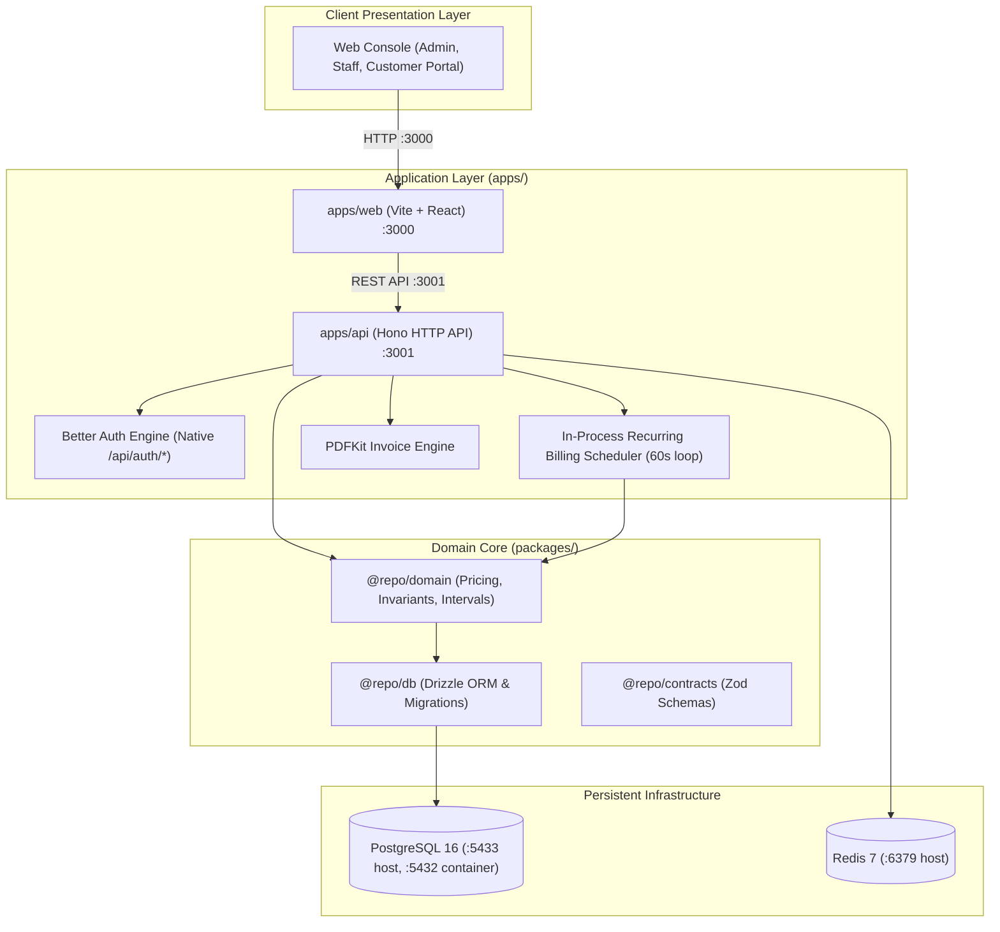

# System Architecture & Component Overview

> **High-Level Technical Blueprint & Runtime Topology**  
> **Platform:** Brightloop Subscription Management System  
> **Updated:** 2026-10-31

---

## 1. Monorepo Structural Blueprint

Brightloop is structured as a clean TypeScript modular monorepo managed with `pnpm workspaces`:

```
subscription-management/
├── apps/
│   ├── api/                      # Hono REST backend, PDFKit generator, Better Auth endpoints (Port 3001)
│   └── web/                      # React frontend, Industrial Precision UI, Lufga typography (Port 3000)
├── packages/
│   ├── contracts/                # Shared Zod validation schemas and DTO types
│   ├── db/                       # Drizzle ORM schemas (16 tables), PostgreSQL client, seed dataset
│   └── domain/                   # Pure pricing engine, financial math, recurring billing service
├── data/                         # Persistent host mounts (Postgres data, Redis data)
├── docs/                         # Structured documentation vault, runbooks, design specs
├── docker-compose.dev.yml        # Local isolated services (PostgreSQL 16, Redis 7)
└── package.json                  # Root monorepo orchestration scripts
```

---

## 2. Component Runtime Architecture



---

## 3. Network Ports & Communication Map

| Service / Container | Internal Port | Host Port | Protocol | Purpose |
|---|:---:|:---:|:---:|---|
| `brightloop_postgres_dev` | `5432` | `5433` | TCP / PostgreSQL | Authoritative relational store |
| `brightloop_redis_dev` | `6379` | `6379` | TCP / Redis | Cache & queue infrastructure |
| `apps/api` (Hono) | `3001` | `3001` | HTTP | REST API, Better Auth, Billing Scheduler |
| `apps/web` (React) | `3000` | `3000` | HTTP | Industrial precision dashboard & portal |
| Mailpit (Optional dev) | `1025` / `8025` | `1025` / `8025` | SMTP / HTTP | Mock email capture |

---

## 4. Key Invariant Enforcement

1. **Precision & Money Handling**:
   - Zero floating-point math in application logic (`Decimal.js` and pure integer/minor string math).
   - Stored in PostgreSQL using `NUMERIC(14, 4)` columns.
2. **PostgreSQL Advisory Locks**:
   - Transaction-level lock `SELECT pg_try_advisory_xact_lock(89214)` acquired inside `db.transaction()` ensures zero overlap during billing scans and automatically releases locks on transaction close.
3. **Database-Level Idempotency**:
   - Composite unique index on `(subscription_id, billing_period_start)` prevents duplicate invoice generation under all race conditions.
